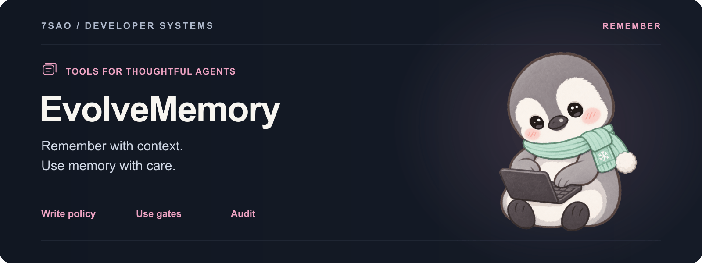
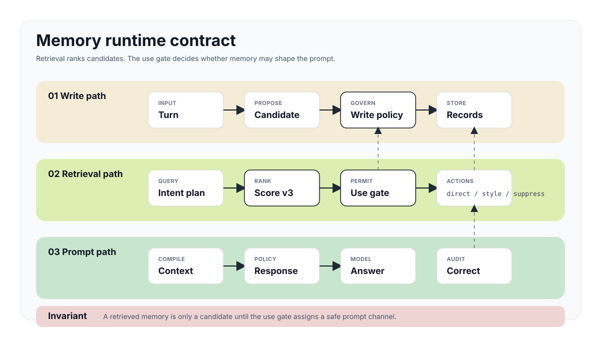

# EvolveMemory

**A memory runtime for AI that learns about people over time, revises its understanding, and adapts naturally.**

<p align="center">
  <a href="README.zh-CN.md">简体中文</a> ·
  <a href="#quick-start">Quick start</a> ·
  <a href="docs/runtime-reference.md">Docs</a> ·
  <a href="#status-and-roadmap">Roadmap</a>
</p>

<p align="center">
  
  <a href="https://github.com/2sao7sao/EvolveMemory/actions/workflows/ci.yml"></a>
  
  <a href="LICENSE"></a>
</p>

## Why EvolveMemory

Long-term collaboration needs more than recalling facts: an assistant should learn stable preferences, recognize change and context, and respond naturally after correction. EvolveMemory explores that experience with inspectable evidence, memory updates, and controls. Project-task continuation is the first test scenario; long-term collaboration and companionship are the vision.

| Capability | Available scope |
| --- | --- |
| Form and revise understanding | Evidence accumulation and correction exist; this revision enables automatic profile adaptation from independent source turns. The U0 rule and API slice passes local checks; user experience remains unverified. |
| Govern writes | Rule extraction and external LLM payload validation; create, merge, review when configured, reject, or retain only for the current turn. |
| Control use | Gate retrieved memories into direct facts, style policy, follow-up cues, hidden constraints, clarification, summary, or suppression. |
| Correct and inspect | Local JSON / SQLite stores, review queue, correction, deletion, forget-all, and audit export. |
| Reproduce behavior | Offline replay and deterministic regression suites, with inspectable scoring factors. |

This is a research prototype using rules and externally supplied `llm_payload`, not an integrated model provider. On 2026-11-16 the user replaced the earlier confirmed-only profile rule: supported ordinary preferences should adapt automatically, while weak evidence stays tentative without default confirmation questions. Settings, scope, source validity, and opt-out remain effective. A complete multi-turn host, broad stable/change/context reasoning, and the intended natural experience are not yet validated.

## Quick start

Requires Python 3.11+. The replay runs locally without a model API key.

```bash
git clone https://github.com/2sao7sao/EvolveMemory.git
cd EvolveMemory
python3 -m venv .venv
source .venv/bin/activate
python -m pip install -r requirements.txt
python -m memory_system.demo
```

Expected output includes `status: PASS`, `accepted_candidates: 4/4`, and `gate_eval: 8/8`. These are fixed replay checks, not a production quality score.

To start the prototype API:

```bash
python -m uvicorn app:app --reload
```

Open `http://127.0.0.1:8000/docs` for the API reference. See the [runtime reference](docs/runtime-reference.md#developer-surface) for SQLite configuration and Python usage.

## How it works

```text
user turn → proposals → write governance → local store
query → retrieval → use gate → response policy → prompt context
feedback → correction / retirement → audit
```



The use gate controls what enters the prompt; a retrieval score alone never grants permission. Current semantic scoring uses a deterministic hash embedding substitute. See [scoring and API details](docs/runtime-reference.md), [gate rules](docs/gate-decision-rules.md), and the [architecture proposal](docs/next-development-spec.md).

## Reproduce the example

The replay writes two synthetic user turns, queries them in different contexts, and applies a correction:

| Input | Expected behavior |
| --- | --- |
| “I am preparing for an interview” and “Start with the conclusion” | Preserve the event and communication preference as separate memories. |
| Ask for interview preparation | Use the event as a follow-up cue and apply the style preference. |
| Ask for a Python review and explicitly exclude the interview | Suppress the interview while retaining allowed style guidance. |
| Ask to stop remembering anxiety | Retire the sensitive state and its derived profile signal. |

This existing replay uses the standalone session runtime. Its follow-up examples do not enable v2 event follow-ups, which default to off per event; see the [v2 contract](docs/runtime-reference.md).

```bash
python examples/replay_adaptive_memory.py
python -m unittest discover -s tests -p 'test_*.py'
python -m evals.runner --suite all
```

The merged [PR #15](https://github.com/2sao7sao/EvolveMemory/pull/15) baseline passed 115 local tests (72 pytest subtests), all 11 deterministic suites, the standalone replay, and [hosted CI](https://github.com/2sao7sao/EvolveMemory/actions/runs/43906016401). Those results cover the earlier controls/scope implementation, including its now-superseded profile-confirmation rule. **This revision passed 157 local tests (101 pytest subtests), all 11 deterministic suites, and replay PASS**, using an isolated temporary data directory and no provider. Implementation and hosted Checks are tracked in [PR #16](https://github.com/2sao7sao/EvolveMemory/pull/16). These checks complete the local U0 slice, not experience acceptance U01–U08, a complete host, or real-model helpfulness. See [maintenance evidence](docs/maintenance.md).

## Status and roadmap

**Build toward lasting, revisable understanding; verify it first through project-task collaboration.**

| Priority | Next step | Completion evidence |
| --- | --- | --- |
| U0 — locally checked | Automatic, evidence-backed profile adaptation | Local rules/API regressions pass; remote publication and user-experience acceptance remain separate. |
| Next: S1-a / S0-c | Minimal host and temporary context | Actual delivered input and subsequent answers respect current requests, corrections, and existing scope. |
| S1 experience | A useful project-task continuation | Recover old decisions, change after correction, and avoid repetitive reminders or irrelevant events. |
| S2–S4 | Lasting understanding and real-provider evaluation | Distinguish stable preferences, persistent change, and contextual exceptions; measure helpfulness and correction effort over time. |

[Draft PR #12](https://github.com/2sao7sao/EvolveMemory/pull/12) records the revised direction and remaining protocol. The first project scenario does not reduce the vision to task tracking. See [positioning](docs/positioning.md), the [development plan](docs/next-development-spec.md), and [experience acceptance U01–U08](docs/next-development-spec.md#fixed-experience-acceptance) for the distinction between vision, implementation, and unverified behavior.

## Documentation and assets

| Resource | Purpose |
| --- | --- |
| [Conversation-memory protocol](https://github.com/2sao7sao/EvolveMemory/pull/12) | Autonomous understanding, source/scope boundaries, delivery capture, and fixed experience acceptance; the full protocol is not complete. |
| [Runtime reference](docs/runtime-reference.md) | Retrieval math, activation, causal relevance, write governance, Python and HTTP surfaces. |
| [Adaptive replay walkthrough](examples/adaptive_memory_replay.md) | Inputs, outputs, and what each seeded check establishes. |
| [Maintenance notes](docs/maintenance.md) | Current evidence, prioritized follow-up, and visual asset inventory. |
| [Positioning](docs/positioning.md) · [Phase 2 design](docs/phase2-optimization-spec.md) | Intended use and proposed future architecture; targets are not measured results. |

## Contributing and related projects

See [CONTRIBUTING.md](CONTRIBUTING.md) and [SECURITY.md](SECURITY.md). Use synthetic examples; keep real transcripts, local stores, credentials, and private debug exports out of commits. Licensed under [MIT](LICENSE).

Related projects: [Agent Peak Bench](https://github.com/2sao7sao/agent-peak-bench) for agent evaluation, [EvolveKB](https://github.com/2sao7sao/EvolveKB) for knowledge workflows, and [Video Analysis Skills](https://github.com/2sao7sao/video-analysis-skills) for structured video analysis. These are separate repositories, not a claim of an integrated product.
