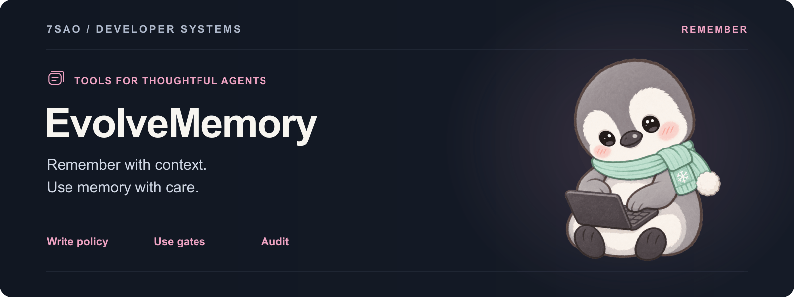
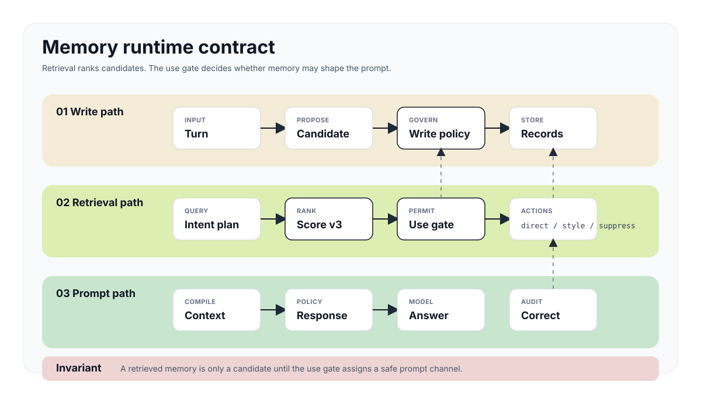

# EvolveMemory

**控制 AI 助手记住什么、以及如何使用记忆的本地运行时。**

<p align="center">
  <a href="README.md">English</a> ·
  <a href="#快速开始">快速开始</a> ·
  <a href="docs/runtime-reference.zh-CN.md">文档</a> ·
  <a href="#状态与路线">路线</a>
</p>

<p align="center">
  
  <a href="https://github.com/2sao7sao/EvolveMemory/actions/workflows/ci.yml"></a>
  
  <a href="LICENSE"></a>
</p>

## 为什么做 EvolveMemory

助手可能检索到正确记忆，却用错方式。EvolveMemory 分开处理候选抽取、写入决策、检索、允许用途与纠错，让每个决定都可以检查。

| 能力 | 当前范围 |
| --- | --- |
| 治理写入 | 规则抽取与无需真实模型的 LLM payload 校验；支持创建、合并、审核、拒绝或仅保留本轮。 |
| 控制使用 | 将命中项分配为直接事实、风格策略、追问线索、隐藏约束、澄清、摘要或抑制。 |
| 纠错与检查 | 本地 JSON / SQLite 存储、审核队列、纠错、删除、全部遗忘和审计导出。 |
| 复现行为 | 离线回放与确定性回归评估，保留可检查的评分因子。 |

项目处于研究原型阶段。生产级 embedding、真实 provider 抽取、宿主对话编排与生产安全尚未完成端到端验证。authority、scope、lifecycle、interaction 等模块已有本地实现，但模块存在不代表所有 API 路径均已完整接通。

## 快速开始

需要 Python 3.11+。回放在本地运行，不需要模型 API Key。

```bash
git clone https://github.com/2sao7sao/EvolveMemory.git
cd EvolveMemory
python3 -m venv .venv
source .venv/bin/activate
python -m pip install -r requirements.txt
python -m memory_system.demo
```

预期输出包含 `status: PASS`、`accepted_candidates: 4/4` 与 `gate_eval: 8/8`。这些是固定回放检查，不是生产质量分数。

启动原型 API：

```bash
python -m uvicorn app:app --reload
```

在 `http://127.0.0.1:8000/docs` 查看接口。SQLite 配置与 Python 用法见[运行时参考](docs/runtime-reference.zh-CN.md#developer-surface)。

## 工作流程

```text
用户输入 → 候选记忆 → 写入治理 → 本地存储
当前问题 → 检索 → 使用门控 → 回答策略 → Prompt 上下文
反馈 → 纠错 / 退役 → 审计
```



使用门控决定什么可以进入 Prompt；检索分数本身不授予使用权限。当前语义评分使用确定性哈希 embedding 替身。详见[评分与接口](docs/runtime-reference.zh-CN.md)、[门控规则](docs/gate-decision-rules.md)和[架构方案](docs/next-development-spec.md)。

## 复现实例

回放写入两条合成用户输入，在不同任务中查询，最后执行纠错：

| 输入 | 期望行为 |
| --- | --- |
| “我最近准备面试”与“先给结论” | 分别保存事件与沟通偏好。 |
| 询问如何准备面试 | 将事件作为追问线索，并应用风格偏好。 |
| 只做 Python review，明确不要提面试 | 抑制面试信息，保留允许的风格指导。 |
| 要求不再记住焦虑 | 退役敏感状态及其派生画像信号。 |

```bash
python examples/replay_adaptive_memory.py
python -m unittest discover -s tests -p 'test_*.py'
python -m evals.runner --suite all
```

2026-11-16 维护检查在两项定向修复后通过 72 个本地测试和全部 11 个确定性评估套件。范围包含固定案例及 FastAPI TestClient 对 HTTP 处理函数的验证；尚不能证明真实模型帮助程度、大规模检索、生产时延或线上服务可用性。完整证据与修复前失败见[维护记录](docs/maintenance.md)。

## 状态与路线

**建议继续维护，下一里程碑优先保证正确性，并打通一条完整对话路径。**

| 优先级 | 下一步 | 完成证据 |
| --- | --- | --- |
| P0 | 两条 v2 读路径遵守记忆禁用；迁移测试不依赖真实日期 | 规范化存储、旧会话回退、重新启用及过期边界回归；本次维护已包含。 |
| P1 | 评审 [Draft PR #12](https://github.com/2sao7sao/EvolveMemory/pull/12)，确定宿主协议 | 明确作用域和对话默认行为，再独立实现并验收首个切片。 |
| P1 | 在单线程循环中接通作用域、纠错与生命周期检查 | 覆盖旧决定、禁用、过期事件及上下文交付的可回查案例。 |
| P2 | 引入真实抽取 / embedding provider 并测量 | 有版本的数据集、配置、费用、时延和失败案例。 |
| P2 | 恢复产品页发布路径 | Pages 部署成功，并独立确认线上 URL。 |

PR #12 仍是讨论草案，不代表运行时已经交付。最近观察到的该 PR CI 因既有的时钟依赖迁移测试失败；此处的本地修复不等于已重跑或批准该 PR。治理界面、存储与安全等后续工作见[维护状态](docs/maintenance.md)和[下一阶段 Spec](docs/next-development-spec.md)。

## 文档与素材

| 入口 | 内容 |
| --- | --- |
| [对话记忆协议](docs/conversation-memory-invocation-spec.md) | 多轮调用、作用域证据与上下文交付的讨论草案；不代表完整运行时已经实现。 |
| [运行时参考](docs/runtime-reference.zh-CN.md) | 检索数学、激活、因果相关性、写入治理、Python 与 HTTP 接口。 |
| [回放说明](examples/adaptive_memory_replay.md) | 输入、输出与固定检查能够证明的范围。 |
| [维护记录](docs/maintenance.md) | 当前证据、优先级待办及展示素材清单。 |
| [产品定位](docs/positioning.md) · [Phase 2 设计](docs/phase2-optimization-spec.md) | 使用范围与后续架构；目标值不是实测结果。 |

## 贡献与相关项目

参见 [CONTRIBUTING.md](CONTRIBUTING.md) 与 [SECURITY.md](SECURITY.md)。使用合成样例，不提交真实对话、本地存储、凭据和含隐私的调试导出。许可证为 [MIT](LICENSE)。

相关项目：[Agent Peak Bench](https://github.com/2sao7sao/agent-peak-bench) 用于 Agent 评估，[EvolveKB](https://github.com/2sao7sao/EvolveKB) 用于知识工作流，[Video Analysis Skills](https://github.com/2sao7sao/video-analysis-skills) 用于结构化视频分析。它们是独立仓库，不代表已经集成为同一产品。
