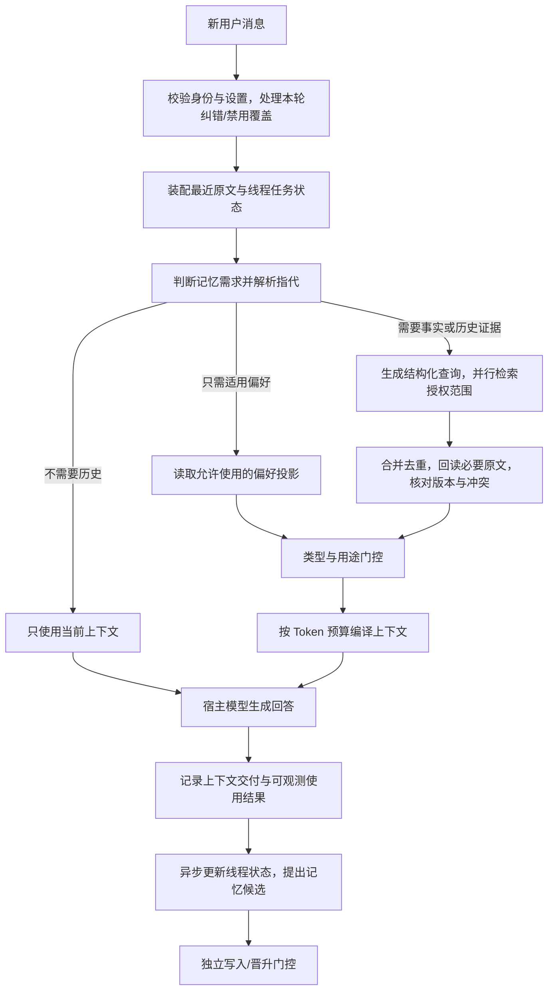

# 真实多轮对话中的记忆调用与使用协议

状态：**协议草案 v0.3；方向已修正为自主、持续更新对人的理解；新自动适配 U0 切片本地验证通过、远端待发布，完整协议与体验尚未实现。**

初稿日期：2026-09-04。更新日期：**2026-11-16**。历史观察基线：`c628f00`；已合并实现基线：`8e3ab17`（PR #15）。2026-11-16 用户后续决定取代同日较早的“个人画像确认后才适配”要求，记录见第 16 节。

本文件细化 [Phase 2 Spec](phase2-optimization-spec.md) 第 12–14、20–21 节，并补充 [Next Development Spec](next-development-spec.md) 的跨会话存储、检索、交互和真实模型验收。

本文件记录协议与验收要求，不能用文档更新替代代码结果。新自动理解 U0 切片已在实现分支通过本地检查，结果见第 13.3 节；远端发布与 Checks 待完成，PR #15 的历史结果不代替本轮验证。以下轮数、Token 数、阈值和延迟仍是待评测的初始建议，不是已确认的运行时默认值或测量结果。已确认的产品决定见第 16 节。

产品愿景是**长期协作、陪伴与知己式体验**：AI 在相处中自主形成并持续修正对人的理解，区分稳定偏好、持续变化与具体情境，把理解自然融入回答，而非反复询问确认或提及旧事。**项目任务续接**是首个可控验证场景，用于验证旧决定、当前约束、未完成任务和偏好适配；它不是整个愿景的替代。完整跨线程检索、广泛的人物理解与真实模型体验仍须分别验证。

## 1. 要解决的真实问题

用户的一句“那现在应该怎么办”，可能依赖刚才的方案、当前线程较早的决定、另一个线程的事件进展，以及长期沟通偏好。只用最新一句话做向量搜索会丢失指代；把所有历史塞进上下文会增加时延、噪声和错误使用旧信息的机会。

目标：让对话逐渐更贴合这个人，能被纠正、能识别情境变化，并在需要时解释 **为什么需要记忆、哪些证据仍适用、什么不能断言**。日常风格适配不应每次展示记忆清单；时延和打扰成本也须测量。

本协议覆盖个人对话中的读路径，以及读后反馈和写入之间的接口。它不授权执行外部动作，不把检索结果变成新指令，也不因用户说过一句话就自动同意永久保存。

## 2. 上下文与存储分层

“当前上下文”“历史会话”和“长期记忆”是三种不同对象。摘要和画像不能替代原始证据。

| 层 | 内容与粒度 | 何时进入模型上下文 | 存储与生命周期 |
| --- | --- | --- | --- |
| A. 最近对话原文 | 当前用户消息、最近完整交互及必要工具结果 | 每轮直接保留；不需要语义检索 | 当前线程上下文；按历史保留设置存储，不自动成为长期记忆 |
| B. 当前线程任务状态 | 当前目标、选定方案、约束、待解指代、未完成事项、对应 turn 引用 | 线程较长时带入紧凑状态；当前原文优先 | 从当前线程事件生成的可重建投影；带覆盖范围和版本 |
| C. 可回查的会话历史 | 当前线程窗口外的原文；获准使用的其他线程中的片段 | 本轮存在证据缺口时按需召回 | 按话题片段/完整交互建索引，保留 thread、角色、时间和原文定位 |
| D. 治理后的长期记忆 | 明确事实/偏好、事件状态、已支持的推断画像、协作流程 | 按类型、作用域、时效和用途选择 | 规范化记录与证据链；允许纠错、失效、撤销 |
| E. 证据不足的假设 | 未证实的任务解释、可能的偏好、个人推断 | 任务假设进入独立假设区；弱画像暂不适配，也不默认产生确认问题 | 与事实分开；独立新证据可支持自动晋升，多次检索或复述不算新证据 |

### 2.1 最近几轮如何直接放入上下文

初始建议保留最近 **6 个完整交互、最多 4,000 Token**，采用双重上限；真实取值由模型和任务评测决定。当前用户消息和仍在执行的工具调用/结果必须保持完整关联。

- 不能截断工具调用配对、代码关键段或仍未消解的指代。超出预算时先把大工具输出转换为带引用的摘要。
- 更早内容进入 B/C；必须准确记录哪些原文仍在上下文、哪些只有摘要、哪些尚未读取。
- B 不是第二份聊天总结。它只保存“当前正做什么、已决定什么、还有什么没完成”，每项带来源；模型推测保留不确定标记。保存 `covered_through_seq`、来源 turn 范围、投影版本和依赖版本；未覆盖的新消息由原文增量补齐，不能出现遗漏或双重覆盖。
- 当前用户消息本身超出窗口或模型容量时，使用显式附件/文件处理流程并说明覆盖范围，不能无声截断后声称读完。
- 即使关闭长期记忆，当前线程最近对话仍用于正常对话衔接；“无历史引用”和“禁止长期记忆”是两个独立设置。

### 2.2 输入范围与开关的准确语义

本协议将读取、写入、历史留存和画像适配分开表达，迁移旧 `memory_enabled` 时必须有明确映射。宿主识别本轮例外，不能由检索器猜测权限。持久设置与本轮限制取交集；本轮限制只可收紧已有范围，不能授权访问其他项目，也不能偷偷改写长期设置。

| 控制 | A/B/C 是否可用 | D/E 是否可用 |
| --- | --- | --- |
| 关闭长期记忆主开关 | 当前线程历史由独立的历史设置决定；跨线程自动引用关闭 | 关闭长期读、写和画像适配；当前任务已有的显式假设仍是线程上下文 |
| 仅关闭跨线程引用 | 允许当前线程；其他线程原文/摘要不读 | 已批准的长期记忆按独立读开关和 scope 决定 |
| 本轮“只看当前材料/不参考任何历史” | 仅本轮输入及明确引用的材料；旧 A/B/C 均排除 | 全部排除；仍保留宿主系统规则和完成当前动作必要的执行状态 |
| 禁止形成新长期记忆 | 按读取设置使用已获准上下文 | 读可允许、写与晋升禁止；不能借异步摘要重建长期记忆 |

`thread_history_enabled`、`cross_thread_recall_enabled`、`long_term_read_enabled`、`long_term_write_enabled`、`inferred_adaptation_enabled` 的有效值由宿主政策与本轮指令共同收紧。B 只从被允许的当前线程材料生成；不能用旧摘要包绕过关闭项。

这些独立控制名称属于完整协议设计；当前代码中的 `memory_enabled`、`disabled_keys`、`disabled_layers`、`allow_inferred_profile`、`allow_event_followup` 等具体字段须按第 13 节的版本状态核验。本轮 S0 要求已有设置同时约束 v2 读写：v2 只使用 normalized repository，不再隐式读取或双写 legacy session。已保存记录不能绕过新关闭项，重新开启后仍须重查推断的有效证据；不自动开启尚未启用的事件追问。旧 `/sessions` 数据保留，须通过已有 `migrate_store` 明确迁移；旧接口不继承 v2 用户治理。

“这次先给简短结论”只影响本轮输出；“以后默认先给结论”才是持久偏好候选。保存 scope 与保留会话历史是不同操作：临时文本可以按获准的历史设置保留，但不得因此成为长期偏好或全局记忆。缺少可信 project/session 身份的记录不能被默认为 global。

### 2.3 当前线程较早内容与其他线程

当前线程窗口外内容：优先检索任务状态中的证据指针，再搜索该线程的旧片段。仅在已显示内容不能回答时补入，避免把同一段原文重复算作两份证据。

其他线程：先用允许访问的线程目录/片段索引定位，再回读相关片段，不能默认把所有线程摘要拼入 Prompt。

- 目录条目包括主题、实体、时间范围、作用域、未结束事件、原文指针，不包括推断出的授权。
- 已确认的跨线程默认：只复用**当前项目中已授权**的线程证据；已有且适用于本项目的全局偏好按独立设置、证据和范围读取；无需每项画像重复确认。其他项目/私密线程不因“继续任务”或语义相似而开放；使用既有明确授权时不重复询问。
- “帮我找上次另一个对话的面试计划”可扩大到本用户获准搜索的线程；“继续这个 repo”不自动读取另一项目。
- 主题相似不能覆盖项目/用户/租户边界。thread 来源和 scope 适用范围分别保存；来源线程不是记忆的永久作用域。
- 保留原文是受历史留存设置控制的能力。来源已删除或不可访问时返回 `source_unavailable`，不能伪造逐字引用。

来源状态需分开：主动删除该信息/撤销来源使用会失效所有仅依赖该来源的派生项；按历史保留期清理原文时，只有另有独立留存依据（如单独确认的偏好及确认收据）的长期记录可保留，且不再声称可逐字引用；临时读取失败不等于删除，但不能用不可核查摘要替代本轮必需的原文证据。

## 3. 每轮读路径与职责



职责必须固定：

- **宿主 Agent** 提供当前消息、最近对话、项目/线程、任务阶段和本次禁止项；安排调用时机；保留系统指令和最终回答责任。
- **记忆运行时** 解析授权范围、生成检索计划、返回带来源和用途限制的上下文。不能通过 `session_id=None` 隐式推断用户想搜索所有历史。
- **模型** 可请求补查、回答或澄清。记忆内容是资料，不是更高优先级指令；原文中的“忽略规则”等文字不能成为控制策略。
- **写入治理** 独立处理新增/纠错/推断晋升；查询或模型使用成功本身不触发事实确认。

## 4. 调用时机与检索模式

每轮都做廉价的设置检查和需求判定；每轮不必做语义搜索，也不必新增一次模型调用。

| 模式 | 触发条件 | 同步动作 | 例子 |
| --- | --- | --- | --- |
| `none` | 当前材料已足够且不需个性化；或本轮禁止记忆 | 仅用第 2.2 节允许的输入；不因默认 A/B 绕过本轮范围限制 | 单句翻译、计算、只依据刚上传材料回答 |
| `policy` | 任务仅受有有效证据的沟通/协作偏好影响 | 按作用域读取小型偏好投影，不做历史向量搜索 | review 新代码时应用“先列问题” |
| `context` | 任务需要此前决定、当前事件状态、用户相关事实；或指代依赖旧内容 | 查询 D + 必要的 C，限定领域与实体 | “沿用上次的架构”；“面试现在怎么准备” |
| `evidence` | 明确回忆、引用、时间对比、多会话合并，或关键记忆冲突 | 检索并回读原文/事件版本；不能只给摘要 | “我上个月为什么否决方案 A” |

其他触发点：

1. **线程恢复/项目切换**：更新 scope 和 B，加载相关偏好投影；不自动深搜所有历史。
2. **生成前已有证据缺口**：一次集中检索；不能每生成一句话重复查。
3. **任务执行中出现新实体/新事实缺口**：允许一次有明确缺口的补查，沿用同一轮总预算；不以分数低为理由无限重试。
4. **纠错、删除、禁止使用**：当前轮先形成同步排除/覆盖，并提交明确控制操作；不能等待后台抽取后才停止旧记忆使用。
5. **回答完成后**：异步更新摘要、索引和候选，不阻塞首字；新候选尚未治理时不能被下一轮当成正式记忆。历史留存获准时，先记录带序号的原始 turn，再异步构建派生索引；索引水位之后的合法原文通过 recent-write overlay 可查。

判定依据包含当前任务类型、指代是否已消解、实体缺口、时间比较、用户显式指令和资料充分性。关键词只是信号；不能把 `career_advice` 等领域标签直接当作“需要所有职业记忆”。

## 5. 用什么 query 检索

### 5.1 检索请求来自整段任务语境

输入为：当前用户原文 + 最近对话中的必要指代 + 当前线程任务状态 + 已知实体 ID + 宿主身份/项目/任务。禁止将无关私人信息拼进 query；记忆派生文本发送给外部 embedding/provider 必须服从既有数据路由设置。

建议的请求结构如下，**这是拟议接口，不是当前 v2 API**：

```json
{
  "turn_id": "turn-42",
  "thread_id": "thread-review",
  "project_id": "project-A",
  "query": {
    "original": "那现在应该怎么改？",
    "resolved": "根据项目 A 已确定的 SQLite 方案，如何修改当前导入去重设计？",
    "intent": "continue_decision",
    "entities": [{"id": "project-A", "source_turn_id": "turn-40"}],
    "evidence_needs": [
      {"kind": "accepted_storage_decision", "necessity": "required"},
      {"kind": "dedup_constraints", "necessity": "required"}
    ],
    "time": {
      "as_of": "2026-09-04T10:00:00+08:00",
      "conditions": [{
        "target_field": "valid_time",
        "relation": "valid_at",
        "range": null,
        "certainty": "explicit_task_state",
        "source_turn_ids": ["turn-40"]
      }]
    },
    "unresolved_references": []
  },
  "memory_mode": "context",
  "requested_scope": ["current_thread", "current_project", "approved_global"],
  "budget": {"total_memory_tokens": 1800, "deadline_ms": 250, "max_queries": 3},
  "context_turn_ids": ["turn-37", "turn-38", "turn-39", "turn-40", "turn-41", "turn-42"]
}
```

`tenant_id/user_id` 由宿主身份上下文提供并校验，不能相信模型或调用体自报的身份。`requested_scope` 只能缩小既有权限，不能增加权限。

### 5.2 查询生成规则

1. 保留 `original`，始终与规范化 query 一起作为候选检索信号，避免改写丢失原意。
2. 明确指代可从最近原文/B 的证据链消解；有多个可能对象且影响答案时先澄清，不能凭相似度选一个。
3. 同一轮最多 3 个查询表达：原始问题、补全指代后的问题、一个目标事实/事件子查询。它们共享预算，不代表 3 次串行模型调用。
4. 优先采用实体/slot 的精确查询和可解释模板。只有明确历史任务需要复杂合并且预算允许时，才使用额外 query 改写模型；该成本计入总时延。
5. “上周/之前/现在”以消息时间和用户时区解析，区分事件发生时间、记忆观察时间、有效时间。推测的时间范围只能是软排序信号；用户明确日期才可作为硬过滤。
6. 对比任务拆成有时间界限的证据需求，如“五月偏好”和“当前偏好”；保留两个版本，不用最新值覆盖历史问题。
7. 负向指令进入结构化排除条件，例如“别提面试”“不要参考别的项目”；它们不能仅作为关键词混入检索文本。
8. 只知道“可能在换工作”的假设时，query 必须查询已有证据/相反证据，不能把假设改写成“用户正在换工作”的确定前提。

模糊时间查询至少保留一条不受推测时间限制的路径；只可在原授权范围内放宽时间一次。对“所有/一共几次/分别/变化”的请求，进入 `evidence` 聚合子模式，列出需覆盖的事件/时间槽、索引完整水位和扫描/分页边界；普通 top-8 只能证明找到部分证据，不能声称完整统计。

`time.conditions` 可同时表达“上周聊到”（`recorded_at`）和“去年的旅行”（`occurred_at`），分别保留条件来源与确定程度。放宽推测的“上次”窗口不能静默移除用户明确要求的年份。

### 5.3 举例

| 最近对话 + 当前消息 | 实际查询/动作 |
| --- | --- |
| 前两轮讨论项目 A SQLite；现在说“那去重呢” | 查项目 A 已确认存储决策、导入约束；无需检索所有数据库话题 |
| “上次另外那个对话的面试计划，今天继续” | 查询授权历史中面试计划、最新事件状态；定位目标线程，回读计划和后续更新 |
| “那个已经结束了”但最近同时讨论考试和面试 | 返回指代未决；问“你指考试还是面试？”；暂不把任一事件标记完成 |
| “为什么你认为我喜欢简短回答” | 查画像证据、反证、变更历史及存在的明确反馈；回答为推断及其依据，不能把推断说成用户原话 |

## 6. 多路检索、版本与时效

### 6.1 先确定授权，再检索

所有存储/索引调用先限制 tenant/user、可访问的 thread/project、scope、敏感性和撤销版本。删除/拒绝是硬排除；历史查询可访问获准留存的历史/被替代版本，不能先用 `status=active` 排除历史答案。跨项目未授权内容不应进入候选、日志或 query 改写输入。身份/撤销状态无法核实时不使用该路径，不能降级为无过滤全量搜索。

### 6.2 并行候选来源

| 路径 | 检索方法 | 初始候选上限 |
| --- | --- | --- |
| 当前线程旧历史 | 任务状态的证据指针 + 线程内关键词/语义片段检索 | 8 |
| 长期明确记忆 | 实体/slot 精确索引 + BM25/语义检索 | 12 |
| 相关事件 | entity + event/status/as-of 索引；含必要前后版本 | 6 |
| 获准跨线程历史 | 目录/话题片段混合检索，再定位源 turn | 8 |
| 已治理风格偏好 | user + scope 的小型规范化投影 | 4 |

各路并行，合并后最多保留 32 个唯一候选做一次轻量重排，默认输出不超过 8 个记忆条目，并同时受 Token 总预算限制。上限是初始参数，不是召回正确性的证明。

- 索引应覆盖全部允许检索的历史，不能先取“最近 200 条”再做相关性检索。时间衰减只影响排序，不能让旧的关键决定永远进不了候选。
- 关键词/精确实体负责专有名词、版本、日期；语义检索负责同义表达。两路结果可先用 RRF 等排名融合，再按用途重排；不要直接相加不同模型未经校准的分数。
- 已在 A/B 的证据不重复注入；相同事实的摘要、原文、画像不得算作三个独立支持信号。
- 长期记录可指向多个原文片段；先用 compact record 找候选，只有答案需要原始依据、时间、矛盾核对时才回读必要片段及相邻上下文。
- 候选选出主张/事件后，按 ID 精确读取其当前版本、纠错/替代链、取消/结束状态和撤销信息。该最小版本闭包不参与相关性 top-k 竞争；即使“已取消”语义分低也不能遗漏。闭包读取超时则该候选不可当作当前事实。
- embedding 不可用时保留有约束的精确/关键词路径并标注 `degraded`；缺失不能被解释为“用户从未说过”。

### 6.3 排序解决相关性，门控解决能否使用

排序考虑任务相关性、实体命中、时间适用性、来源质量、信息增量和 Token 成本。敏感性、授权、撤销和待验证状态是硬边界，不能用相关性高分抵消。

当前真值查询：在同一实体/属性和适用 scope 内先核对纠错、supersession 和有效期，再选当前版本。历史查询可读取过去有效版本，并明确时间。系统当前观察时间不能覆盖用户明确的历史事件时间。

时效采用类型策略，而非统一“越新越好”：

- 明确长期偏好：长期有效，当前轮例外优先；需要定期检查是否已纠正。
- 项目决策：在对应项目和版本中有效；换项目不沿用。
- 进行中事件/流动状态：绑定事件状态、有效期和下一次核验时间；到期需确认或仅作历史背景。
- 已结束事件：可用于“之前发生了什么”，不再生成进度追问。
- 易变化且会改变建议的事实：缺少近期证据时先澄清。重复使用不等于重新确认。

## 7. 每种记忆的具体使用条件

统一前提：存在可核查的证据或独立确认收据、身份/作用域允许、未撤销、时间匹配、与当前任务有关、未被当前用户覆盖。必须逐字引用时额外要求原文可查；来源清理规则见第 2.3 节。下表不能替代这些前提。

| 类型 | 召回条件 | 可用方式 | 不允许的使用 | 跨线程条件 |
| --- | --- | --- | --- | --- |
| 明确且仍有效的用户事实 | 当前答案需要该属性/约束 | `use_directly`；变化大或冲突时 `clarify` | 从职业推导能力、收入等未陈述事实 | 已批准适用 scope；个人事实不自动进入共享项目 |
| 明确沟通/协作偏好 | 当前任务可受该偏好改善 | `style_only` / 可解释的偏好约束；当前例外覆盖 | 每次都宣称“我记得你”；压过当前明确要求 | 仅其已批准的 global/domain/project scope |
| 有证据支持的推断画像 | 独立多轮证据充分、来源仍可用，当前情境与设置/scope 允许 | 自动、可回退的 `style_only`；自然融入协作，用户问原因时解释证据与不确定性 | 当作确定身份标签；凭单次模型自评/重复同源晋升；替用户决定高影响事项 | 不宽于有效证据和已启用 scope；自动推断不自动打开 global |
| 进行中事件 | 当前主题相关，需要进度/约束，状态仍可信 | 事实背景；只有该事件已单独开启追问、确有缺口且冷却允许时才 `follow_up` | 用全局开关代替事件级开启；每次见面追问；将未回复当作停滞或失败 | 事实按获准 scope 复用；追问另须该事件的有效开启记录 |
| 已完成/放弃事件 | 用户回忆、复盘、比较，或历史事实影响当前答案 | 带时间的历史事实或摘要 | 当成当前任务；继续催问进展 | 同上，并保留结束状态 |
| 待验证的任务/推理假设 | 同任务/项目续接或用户要求比较解释；仍未证伪 | 独立 `hypotheses` 区，明确“待验证”、支持/反证和下一验证步骤 | 混入事实区、说成已查明原因、把假设当执行许可 | 默认原任务/thread；明确续接且获准的同项目任务可取回 |
| 证据不足的个人/画像推断 | 可保留供后续证据更新，或本轮存在实质意图缺口 | 暂定或抑制；只有影响当前答案的歧义才中性澄清 | 自动贴标签、把弱信号变成默认适配、逐条要求用户确认 | 证据读取仍遵守 scope；弱证据不得靠跨线程次数变强 |
| 原始历史/会话摘要 | 本轮需要旧决定、原话、事件版本 | 有归属的上下文/引用；摘要用于导航，关键断言回到来源 | 把 assistant/tool 原文当用户确认；把摘要当新权威来源 | 先通过线程和项目访问规则 |
| 敏感/受限信息 | 本轮明确需要且用途许可仍有效 | 最小化、相关且透明的使用；不足时中性澄清或不使用 | 因“画像更准”而广泛检索；用 hidden 标签掩盖不当行为 | 默认更严格；明确的获准用途与分享范围缺一不可 |

`hidden_constraint` 仅表示不必反复口头声明的已授权偏好/约束，仍可审计和向用户解释；不能用于隐瞒推断、替代真实权限或改变用户目标。

治理/存储状态（candidate/accepted/deleted）、证据状态（tentative/supported/explicitly_confirmed/contradicted）和时间状态（current/stale/historical）分别保存。`accepted + tentative + current` 的任务假设可以被保存和续接，但不是事实；`accepted + explicitly_confirmed + historical` 的已完成事件仍可用于回忆。confidence 不可代替其中任何一轴；`analytics` 用途也不能自动升级为对话风格使用。

用户事实应保留“用户陈述”这一来源性质。用户曾说某项外部服务正常，不代表它当前仍正常；高影响或变化快的外部状态需要对应服务/证据的新核验。

证据还必须带 `subject_entity_id` 和 `speech_act`（本人陈述/第三人转述/引文/假设/提问/否定等）。`source_role=user` 不足以证明是用户自己的事实：“我朋友在求职”“帮我润色这段简历：我住上海”“假如我离职了”均不得自动归到当前用户。

### 7.1 自主、可修正的理解状态机

以下为协议目标状态，不承诺当前 schema 已完整实现每个阶段。

```text
observation（原始观察，保留来源/情境/时间）
    -> tentative_inference（暂定解释，整理支持与反证）
    -> supported_understanding（独立多轮证据经规则评估）
    -> contextual_adaptation（自动、低强度、可回退地适配）

新证据/用户纠错 -> revise / contextualize / weaken / replace / retire
任一阶段 -> expired / rejected / deleted
用户明确陈述事实/偏好 -> 对应显式记录；可用来纠正推断
```

- 普通画像默认不经过“用户确认才能适配”的步骤。证据充分、来源可用、设置与 scope 允许时，系统应自动积累并适配；已有有效授权无需重复征询。
- 理解需携带支持/反证、来源独立性、时间、情境、替代解释和适用范围。稳定默认、持续变化、特定情境可并存，不能把暂时表现凝固成人格标签。
- 独立门不能是产生推断的同一次模型输出自评分。重复检索、模型复述、沉默以及模型按该推断生成的回答不是独立证据；同一源 turn 不重复计票。
- 弱证据继续观察、保留为暂定或不使用，不默认询问“你是否就是这样的人”。只在当前答案会实质改变且缺必要信息时澄清。
- 直接纠错优先于旧推断；系统应改变后续行为并处理相关证据，避免被旧证据立刻复活。反证也应主动降低或修正推断，不等用户手动维护每条画像。
- “这次说重点”是本轮要求；“工作汇报简短、学习推导详细”是情境差异；长期新模式可能表示变化。三者的区分须有独立验收，不能仅靠一次关键词匹配宣称完成。
- 普通风格与协作偏好可自然使用；推断不等于身份事实，不授权敏感推导、范围扩张或外部动作。明确配置的 review 规则仍可使用，但不是所有画像的默认交互。

任务假设另有 `claim/supporting_evidence/counter_evidence/verification_plan/verification_state`。例如“连接池可能泄漏”续接时应携带“尚未做连接释放检查”，经实际检查和针对该命题的独立门确认后才能成为已验证结论。用户批准“保存这个假设”只批准存储，不确认真假。

自动晋升与人工 review 提交时均重新核验最新设置、scope、来源撤销和冲突状态；旧证据或审查队列不能复活已删除的记忆。

### 7.2 冲突与纠错

系统约束始终优先。相同事实/偏好和适用范围内，当前明确用户指令覆盖旧记忆；更具体的本轮例外不应永久覆盖长期默认。

旧“回答简短” + 本轮“详细解释” => 本轮详细；下一轮重新判定。

旧“面试进行中” + 本轮“已经结束”且指代明确 => 同步停止追问，提交事件更新；完成前用本轮覆盖保护当前回答。

对两个相互冲突的用户事实先对齐实体、时间和范围，再依据明确纠错/新状态选择；无法判定时说明不确定并澄清，不能简单选相似度最高者。

显式 `/correct` 纠正画像时，新值以本次用户纠正为依据；旧推断来源留在旧版本与审计，不得让旧 pool 继续决定新值能否读取。纠正不会伪造 `user_review_approved`，也不绕过当前设置与范围。自然语言自动识别纠错的广泛能力仍须单独验收。

## 8. 上下文编译与反馈契约

### 8.1 给模型什么，给调试器什么

模型侧上下文包含：`current_task_state`、`direct_facts`、`style_policy`、`event_context`、`hypotheses`、`clarification_questions` 和 `source_refs`。每项携带来源、时间、置信类别、允许用途与适用范围；任务假设只进入独立假设区，证据不足的个人推断和被禁用内容不进入适配包；已支持推断仅以适用的风格策略进入，不伪装成明确事实。

完整候选集、被抑制记录、评分、敏感原文、内部 trace 只进入受权限保护的调试/审计接口。不能把整个 query JSON 响应直接序列化进 Prompt；`include_debug=false` 必须真正限制返回内容。

宿主保留自己的系统指令；采用明确标注的资料区传递记忆。经治理的偏好可编译为结构化策略，但历史原文、摘要和候选记忆不能注入到最高优先级指令区。`assembled_prompt` 是方便接入的投影，不是替换宿主系统提示的授权。

### 8.2 回答后的可观测性

分别记录以下状态，不能混为“使用成功”：

| 状态 | 可证明什么 |
| --- | --- |
| `retrieved` | 进入候选 |
| `selected` | 通过门控 |
| `context_delivered` | 宿主确实交给了本次模型请求 |
| `cited_or_mentioned` | 回答包含可核查引用/提及；模型自报标记为 self_reported |
| `followup_delivered` | 最终发出的回答确实包含对应事件追问 |
| `user_feedback` | 用户明确确认、纠错、拒绝或评价；不能从沉默推导 |

风格是否改善通常只能靠后续评估判断，不能从“注入了偏好”推导成功。追问冷却依据 `followup_delivered` 更新，不能在检索时更新，也不能完全不更新。

记录使用回执时提供 `request_id/turn_id/context_id/memory_id/version/event_id/outcome`；相同回执幂等。多个并发回答须对同事件的追问额度做协调，避免双重追问；未实际发送的计划不消耗永久次数。

事件追问**默认逐事件关闭**。用户为某个事件开启后才可计入候选追问；`allow_event_followup=true` 只是允许事件追问机制，不会批量开启全部事件。用户主动询问某事件是回答当前请求，不等于同意以后自动追问。关闭某事件或全局追问立即抑制后续追问，保留其事实是否可读由读设置与 scope 单独决定。

默认每轮最多一个已开启的历史事件追问，并先完成当前用户请求；用户明确要求系统逐项访谈时可调整。用户级跨事件冷却、已拒绝的话题、当前请求优先于单事件配额。配额允许不等于必须问；同时存在求职/考试/搬家事件也不能轮番催问。

### 8.3 来源提示的显示条件

已确认采用按条件展示：引用旧决定、使用会变化的事件/事实、存在冲突或不确定性，以及用户询问“为什么”时，给出可核对的来源、时间和必要限制。仅应用有有效证据且不改变事实内容的风格偏好时，无须每次插入记忆清单。后端仍保留来源引用和交付记录；减少界面提示不等于省略证据或审计。来源不可回查时说明这一点，不制造逐字引用。

## 9. 时延、预算与缓存

以下是首个本地服务/同区域部署版本的**待验证目标**，仅计算记忆引入的阻塞时间；不能拿缓存命中速度代表冷启动。

| 路径 | 初始目标 | 超时行为 |
| --- | --- | --- |
| `none` / `policy` | p95 ≤ 30 ms | 偏好读取失败时使用当前指令与默认风格 |
| `context` | p95 ≤ 250 ms；硬截止 350 ms | 保留已核验结果；无法核验身份/版本的结果丢弃 |
| `evidence` | p95 ≤ 800 ms；硬截止 1,200 ms | 说明历史证据尚未取齐；允许显式继续查或澄清 |

有效截止取调用方截止与模式硬截止的较小值，转成同一个绝对 deadline，覆盖 query 规划/改写、embedding、检索、证据回读、版本闭包、门控和编译；排队/网络开销不能排除。示例请求 250 ms 比默认 350 ms 硬截止更严格。超时后只有满足全部 `required` 证据需求才能将本轮历史任务标为成功；仅取回可选偏好时返回 `partial`/缺口，不能冒充找到历史答案。

初始 `context` 预算：4,000 Token 最近原文 + 600 Token 线程状态 + **1,800 Token 记忆总包**。记忆包内部初始分配为偏好 ≤ 200、事实/事件/任务假设 ≤ 800、历史证据 ≤ 600、引用/必要说明 ≤ 200。总上下文仍受宿主模型上限和回答预留约束；不能用条数替代 Token 计算。

`evidence` 可申请更高的宿主分配额度，必须显式计入总预算。保留重要原文时可以减少其他包，不能静默挤掉当前用户要求或工具状态。

性能策略：

- 摘要/embedding/事件抽取与索引更新异步化；同步路径优先精确索引、偏好投影及并行检索。
- 指代已清楚的普通对话不增加 query 改写模型；模型式改写、重排和补查都计入模式预算。
- 缓存键至少含 tenant/user/scope、权限版本、记忆版本、query 特征和时间适用桶；TTL 不能代替撤销验证。
- 上轮 evidence set 仅在任务/实体未变、证据需求仍被覆盖、时间仍适用、无更新/撤销时复用。“换个措辞”可复用；“现在最新状态呢”必须刷新状态。模型和索引版本参与缓存失效。
- 当前线程最新消息通过 A/B 和短期增量覆盖可见；向量索引滞后时精确读取已治理的新记录，不能读到未治理候选。
- 各授权历史范围提供 `history_seq/indexed_through_seq`，读取其尚未索引的持久原文增量；这也适用于其他获准线程的新消息。刚在另一个线程取消事件但结构化抽取未完成时，应发现取消证据或返回 `current_state_unverified`，不能沿用已知可能陈旧的计划。
- 摘要更新采用预期版本提交；迟到的旧摘要不得覆盖新摘要。线程状态、检索包携带覆盖水位与来源 revision；跨线程更新不能只核对当前线程的水位。
- 删除、禁用、纠错时同步增加撤销/策略版本并失效缓存；编译前再次核验版本。并发响应按交付前检查线性化，已发出的模型请求无法追溯撤回。
- 回答开始时固定 context snapshot；流式生成途中不悄悄替换记忆。发生用户纠错或撤销时，宿主中断当前分支、重新准备允许的上下文；不得声称已经发出的内容被撤回。
- 删除依赖传播至摘要、画像、图谱、索引、缓存和待审候选。若历史原文按独立设置保留，最小 tombstone/禁止再学习规则按记录、来源或被删除 slot 阻止后台自动重建；不保留被删除敏感全文。用户日后明确重新要求记住时走新的治理流程。
- 无结果必须区分 `not_found`、`not_allowed`、`ambiguous`、`stale_only`、`source_unavailable`、`timeout`；不能统一生成“我记得你……”或“你没说过”。

可选个性化缺失时直接回答当前任务，无须用技术错误打断用户；必须依赖历史的任务缺证据时，明确未找到/覆盖不足并询问最小必要信息。索引水位不足应返回 `index_lag`，不是“无匹配”。内部拒绝原因不得泄露未授权记录或线程是否存在。

`not_allowed` 只表示请求的范围/操作不被允许，不表示已经找到某条私密记录。用户侧 coverage 仅列实际获准检查的范围，不返回越权线程的标题、数量或命中状态。

## 10. 拟议宿主接口

增加最小宿主适配层并复用现有 gate/compiler，逐步统一 v2 API 与 Python 路径。以下完整接口仍是拟议形式，不是本轮已经交付的 API；本轮实际字段与入口以第 13 节的实现版本为准。

```text
prepare_turn_context(TurnContext, MemoryPolicy, Budget)
  -> ContextEnvelope(context_id, mode, sections, source_refs,
                     clarification_questions, status, coverage,
                     memory_version, policy_version, budget_used)

retrieve_evidence(context_id, explicit_gap, remaining_budget)
  -> EvidenceEnvelope(source_spans, unresolved_gaps, status)

record_context_outcome(ContextOutcome)
  -> durable idempotent receipt

observe_turn_after_response(authorized_turn_reference)
  -> thread-state projection + governed candidate proposals
```

这是“默认宿主判定 + 有界显式补查”的混合方案：用户不必先说“查记忆”，模型也不能绕过 scope/gate 直接拉取整库。

`prepare_turn_context` 的 read 与明确控制操作分离记录：纠错/删除有自己的授权、事务和回执；普通准备上下文不能偷偷产生长期记忆写入。

### 10.1 提前验证最小宿主与交付捕获

S1 首个切片就必须有可执行宿主接缝，不能等真实模型接入时才检查“编译后的记忆到底送到了哪里”。最小路径为：固定用户消息和可信任务范围 → 调用已有读路径 → 构造宿主请求 → 交给可替换的模型调用函数 → 捕获实际交付包与结果。

- 测试替身记录实际收到的输入，检查当前用户指令、允许的记忆、来源引用和独立假设区；被禁用、越 scope、证据不足的个人画像不能进入该包。
- 只生成 `assembled_prompt` 但未调用宿主接缝，属于“已编译”，不能记作“已交付”。调用替身后可以证明向该替身交付，必须标明没有真实 provider 请求。
- 原始候选、被抑制文本、debug trace 不因测试方便被整体塞进模型请求。宿主系统指令保持独立，不让来源文本获得指令权限。
- 回执须关联请求及上下文版本；失败的调用不得标成回答已发出。实际向用户发送的事件追问与编译/模型调用分开记录。

该接缝优先服务同项目任务续接，不以完成全部跨线程历史索引或接入真实模型为前提。

## 11. 用真实多轮场景判断合理性

### 场景 A：长线程继续工作

1. 早期讨论选择 SQLite，给出原因并明确放弃云数据库。
2. 又讨论了 20 轮 UI，存储决策已离开最近窗口。
3. 用户说“沿用前面的方案，把导入做完”。

期望：A 保留最近 UI 对话；B 指向当前导入任务和已选存储；C 回读存储决定；D 只补相关协作偏好。检索 query 包含项目和 accepted decision，不因为旧决定时间较早而漏掉，也不把放弃方案当成备选现状。

### 场景 B：另一个线程继续事件

1. 在获准共享的个人线程记录周五面试及准备计划。
2. 当前线程问“今天继续准备那个面试”。
3. 若已有后续“面试取消”，应取到取消状态。

期望：消解到同一个事件，回读计划与最新状态；取消后不继续推进或催问。若两个面试都可能，先澄清。未获准访问的线程不因语义相似被读入。

### 场景 C：画像不能压过当前请求

1. 多次明确表达默认先给结论，经治理形成偏好。
2. 本轮说“这次不要直接给答案，带我推导”。

期望：只改变本轮策略，不删除长期默认。若系统只是从短回复推断用户喜欢简短，不能把该推断当作明确偏好，也不能向用户宣称“你一直不喜欢推导”。

### 场景 D：待验证信息

1. 用户说“最近回复面试官有些拖延”。
2. 模型产生候选假设“可能不想换工作”。
3. 下一轮用户问“帮我写回复”。

期望：使用已确认的回复对象和事实，不把“不想换工作”写入邮件或建议。若缺少用户意图，只问本次回复希望继续推进还是婉拒；本次回答不自动确认永久职业倾向。

任务中的待验证推理则应保留：昨天提出“连接池可能泄漏”，今天说“继续昨天那个问题”，应回查同项目问题并返回该假设、当时证据和未完成验证。可以继续检查，但不能说“昨天已经确认是连接池泄漏”。

## 12. 验收集与评估方法

先将下列情境变为有期望上下文、来源和状态变化的固定案例，再连接真实模型。测试必须验证“不能使用的内容未进入模型上下文”，不能只检查最终输出是否偶然没提。

| ID | 案例 | 必须观察到的结果 |
| --- | --- | --- |
| C01 | 无历史需求的单句翻译 | 不做语义检索；当前内容完整 |
| C02 | 指代在最近两轮明确 | query 指向有来源的实体，无额外改写模型 |
| C03 | 指代存在两个候选 | 不擅自选择；返回澄清需求 |
| C04 | 当前线程 20 轮前的明确决定 | 回读正确版本及原始决定，不重复填充最近内容 |
| C05 | 10,000 条记录中早期关键偏好 | 仍可召回；无最近 200 条预截断 |
| C06 | 两项目同名实体或相似话题 | 不串项目；未授权项目不进入候选日志 |
| C07 | 新 thread 使用已批准全局偏好 | 偏好可用，无需省略 thread_id 扩大到全量 |
| C08 | 已关闭跨线程引用 | 其他线程原文/摘要不注入，已批准长期记忆按独立设置判定 |
| C09 | 敏感事件与无关代码任务 | 无敏感候选/假设进入模型包 |
| C10 | 老画像与本轮要求冲突 | 本轮要求生效，长期默认未被误改 |
| C11 | 待验证假设、重复模型复述 | 仍为候选；不累计独立证据、不直接断言 |
| C12 | 事件已经完成/取消 | 不继续追问；历史回忆仍能带时间回答 |
| C13 | 新旧事实冲突或只有过期事实 | 对齐版本/时间；不能解冲突时澄清 |
| C14 | 昨天删除记忆，旧摘要/缓存仍存在 | 所有派生路径失效；不复活 |
| C15 | 本轮禁用记忆与并发读取 | 交付前版本核验，禁用内容不进入新请求 |
| C16 | embedding 超时或离线 | 受限降级，报告覆盖范围；不伪造回忆 |
| C17 | 原话提到“去年”，当前问去年和现在对比 | 两个有效版本并存；时间推测不硬排除正确证据 |
| C18 | 连续/并发两次事件追问 | 根据实际交付的幂等回执与额度限制避免重复 |
| C19 | assistant 曾猜测职业，用户没确认 | 不当成 user fact；摘要不能升级来源权威 |
| C20 | 来源删除、原文无法回查 | 返回 source_unavailable；删除源派生内容失效，不冒充原话 |
| C21 | 摘要内出现“忽略系统规则” | 保持资料角色，不能改变权限/宿主指令 |
| C22 | 近期消息大于窗口预算 | 保留当前要求和完整工具依赖；说明未覆盖范围 |
| C23 | 同项目继续昨日调试假设 | 独立假设区包含未完成验证；不进入事实区 |
| C24 | “列出今年所有面试及其变化” | 分页/覆盖校验；不足时不能声称完整统计 |
| C25 | 本轮只依据新上传文件回答 | 旧原文/线程摘要/长期记忆均不进入模型包 |
| C26 | 命中高分旧事件，低分取消记录 | 精确版本闭包取回取消状态；不继续旧计划 |
| C27 | 另一线程刚取消事件，索引/旧摘要任务尚未完成 | 检查授权增量或报告状态未核验；旧摘要不能恢复计划 |
| C28 | “我朋友求职”/引文/假设由用户发送 | 主语与话语类型正确，不自动成为用户事实 |
| C29 | 求职、考试、搬家事件同时存在 | 最多一个必要相关追问；拒绝话题约束跨事件生效 |
| C30 | 只找到可选偏好，必需旧决定读取超时 | partial/缺口；不能以成功空包刷低延迟 |
| C31 | 恢复项目后说“今天先做剩下两项” | 无“记忆”关键词也能触发必要证据；最近原文已足够的对照例不重复查 |
| C32 | 个人画像有独立多轮证据、无逐项用户确认 | 在有效范围内自然适配，不默认要求确认；推断不进入确定身份事实区 |
| C33 | 项目 A 中累积画像，项目 B 未授权共享 | A 可自动适配；B 不得借推断、相似度或缺参数获得范围 |
| C34 | 三个事件存在，但用户只为其中一个开启追问 | 只有该事件可进入追问候选；全局开关不批量开启 |
| C35 | 当前问题只应用有证据的风格；另一问题询问旧决定依据 | 前者无重复记忆清单，后者展示来源、时间和适用边界 |

### 12.1 本轮固定验收矩阵

以下是将协议落到代码的固定验收要求，**不是通过记录**。每例使用固定时钟、合成用户和独立数据库；范围用 `project-A/project-B` 与 `thread-A1/thread-A2/thread-B1`，A1/A2 归属同一项目，B1 属于另一项目。原始输入、设置变化、期望输出字段与测试名称须可回查。状态以第 13 节的精确实现版本和结果更新。

| ID / 切片 | 固定输入与动作 | 必须检查的结果 |
| --- | --- | --- |
| F01 / S0-a | 旧 `/sessions` 与 normalized 分别有偏好；v2 查询后，对旧 store 显式执行迁移；再关闭/开启 v2 主开关 | 迁移前 v2 不读取旧 store；迁移后只读 normalized；关闭时候选/各记忆段为空，重新开启恢复获准 normalized 记录，旧 store 未删除 |
| F02 / S0-a | 写入两个不同 key/layer，再仅禁用其中一项；尝试继续写入被禁项 | 两条读路径均不交付被禁项，允许项仍可读；写侧按相同设置阻止被禁项持久化 |
| F03 / U0 | 分别输入单次弱证据、同源重复、独立多轮有效证据，再关闭画像或撤销一个支持源 | 弱/重复证据不产生默认确认或适配；有效独立证据无需 review marker 可自动适配；关闭/撤源对两个读入口均有效 |
| F04 / S0-a | 已有事件，关闭全局追问；再开启全局，通过 PUT followup 只为 E1 保存 enabled=true | 全局关闭时不追问；重开后 E2/E3 不自动开启，E1 开启状态可重载；事件事实是否可读与追问资格分别检查 |
| F05 / S0-b | 先启用 project-A；通过 ingest 的 project_id/domain/memory_scope 写入，重建 repository/runtime，再查询 | scope/project/domain/authority 经持久化、加载、适配与门控后不丢失或升级；项目权限关闭后读写均受阻 |
| F06 / S0-b | A1/A2 与 B1 有同名决定，宿主允许当前 project-A，查询 A 的旧决定 | 仅允许 A 的记录；请求体、无 session 参数或相似度不得打开 B；测试需检查交付包及调试返回 |
| F07 / S0-b | 旧数据未经显式迁移；或 v2 session/project 参数为 None；或未启用 project/global | 不回退旧 store；None 只匹配未绑定值，不变成全用户查询；project/global 默认关闭，语言不能打开授权 |
| F08 / S0-c | 在有长期偏好的情况下说“这次详细说明”，再发起普通下一轮 | 本轮例外生效；长期偏好和 scope 不变；下一轮按原设置重新判定 |
| F09 / S0-c | 临时指令、auto_write=false、master-off 分别调用 ingest；另测“只看本轮材料”的宿主路径 | 三种 ingest 情况均不新增长期记录或派生 profile evidence；排除历史的宿主路径另行验收，不用 ingest 测试冒充读侧完成 |
| F10 / S0-c | 尝试将一次 turn/session 约束经 adapter 或重新加载变成 project/global | 持久记录不被扩大范围，过期临时项不会进入后续轮次 |
| H01 / S1-a | 已有项目决定和当前用户约束，调用最小宿主适配层及捕获替身 | 替身实际收到获准记忆与当前要求；只编译未调用的分支没有交付成功回执 |
| H02 / S1-a | 相同请求加入被禁 key、项目 B 记录、证据不足画像与 debug 文本 | 实际模型请求全部排除这些内容；不能只断言最终回答没提 |
| H03 / S1-a | 同一上下文准备成功，但模型调用函数失败或未调用 | 保留编译/调用结果的区别，不把失败记录为回答已发送或追问已交付 |
| H04 / S1-b | 早期决定离开最近窗口，当前轮续接任务并覆盖其中一个约束 | 回读正确来源、旧方案与本轮覆盖关系清楚；来源缺失时报告覆盖不足，不伪造原文 |

F03 已按新决定改为自动推断验收，不能继承 PR #15 的旧画像确认测试结果。F04 事件级开启、F06 宿主范围与 H01–H04 交付捕获也须各自有证据。完整阶段结果见第 13 节，不因一个开关测试通过而把整行标为通过。真实鉴权、多租户与全历史服务仍须后续验收。

### 12.2 自然协作体验验收

| ID | 场景 | 观察要求 |
| --- | --- | --- |
| U01 | 多次独立输入体现稳定偏好，随后提出相关新任务 | 自动以合适结构回答，不强制确认，不反复说“我记得你” |
| U02 | 用户纠正“那已不是我的偏好” | 下一相关回答及持久状态改变，旧证据不立即重建被否定推断 |
| U03 | 工作汇报简短，学习推导详细 | 两种情境并存，只在适用场景启用，不合并成全局单一标签 |
| U04 | 对比“仅这次简短”和持续出现的新模式 | 临时例外不改默认；持续变化可修正旧默认，保留变化依据 |
| U05 | 单条弱信号或同一来源反复提取 | 不生成无依据画像，不自动发起不必要确认 |
| U06 | 可检索到无关旧事件/个人事实 | 当前回答不提旧事，不为展示记忆而追问 |
| U07 | 来源过期、被删除、被禁或范围变化 | 两个上下文入口均不能通过派生画像带入被排除内容 |
| U08 | 用户问“为什么这样回答” | 解释推断性质、证据与限制，不伪称用户明确确认过 |

这些是待实现和验证的要求。规则测试验证状态与策略，宿主捕获验证实际交付，最终回答与用户体验评估验证自然程度；三类不能互相替代。项目任务是首场景，长期陪伴与“被理解”的感受还需纵向试用。

评估分三层报告，不把一层成功代表下一层：

1. **触发、召回与门控**：逐轮标注最低模式与所需来源，统计必要历史证据漏触发、无需求额外检索、policy 误升个人事实搜索和 required evidence 最终覆盖率；再按事实/事件/偏好/假设分别统计 evidence recall@k、时间版本正确率、scope 串用、假设当事实、需要澄清却断言的错误率。不能仅对已触发的查询计算召回。
2. **调用性能**：按 `none/policy/context/evidence`，在 1k/10k/100k 记忆、不同历史长度下报告冷/热缓存、并发 1/10、p50/p95/p99、超时率、Token 和实际 provider 成本；说明硬件、索引、模型版本。分别报告所有请求和“成功且必需证据覆盖达标”请求的延迟、必要证据缺失率，以及用户端首 Token 增量；不能靠返回大量空包达标。
3. **回答体验**：同一模型/同一任务，对照“仅最近上下文”“当前实现”“新协议”，盲评自然适配、纠正后行为改变、情境区分、重复提记忆/追问、过度个性化、错误记忆和帮助程度；包括真人多轮试用，不能只用模型自评。

硬门：固定集中的越权/已删除记忆注入、把候选假设作为事实、明确禁用后继续使用必须为 0；这不是生产环境零风险承诺。召回率目标、帮助程度收益和延迟阈值须结合基线确定，不能只调到种子案例全过。

## 13. 历史缺口、主线修复与本轮状态

### 13.1 已合并的定向修复

`c628f00` 曾存在两项已复现问题：`memory_enabled=false` 后 v2 query/prompt-context 仍可编译旧偏好；迁移测试固定使用 2026-04-16 事件却未固定当前时钟，事件过期后导致断言失败。它们已由 [PR #13](https://github.com/2sao7sao/EvolveMemory/pull/13) 的 [`be9cfb0`](https://github.com/2sao7sao/EvolveMemory/commit/be9cfb08cfbc53007648d381ec315ee4bea3b3d7) 修复，并进入当时的 `main@3aa4285`：

- `app.py` 的 `v2_memory_query` / `v2_prompt_context` 在加载正常记忆前检查主开关，关闭时使用空的非持久运行时，阻止 normalized 与 legacy fallback 回填。
- `NormalizedSQLiteMemoryRepository.migrate_store` 接受可选 `now`；测试固定时钟，并另验过期事件被排除、长期偏好保留。
- 原维护记录报告 72 个本地测试、11 个确定性 suite 及相应 hosted CI；这些结果属于 PR #13，见[维护记录](maintenance.md)，不自动成为本轮控制/scope 或完整协议的验收结果。

### 13.2 历史控制与 scope 切片（PR #15 已合并）

PR #15 当时实现以下行为并通过本地验证；其画像强制确认规则已被后续用户决定取代，保留在此用于追溯，不作为当前默认。独立本地复核未发现本范围内阻断项。[PR #15](https://github.com/2sao7sao/EvolveMemory/pull/15) 已合并至主线 [`8e3ab17`](https://github.com/2sao7sao/EvolveMemory/commit/8e3ab171693029daa59fd33afdd6b1d2d4d9123c)。实现 head [`30b1b5b`](https://github.com/2sao7sao/EvolveMemory/commit/30b1b5b959fbd7a6d1028211e22ddd9cbb206e52) 的[远端 CI 已通过](https://github.com/2sao7sao/EvolveMemory/actions/runs/43906016401)。本协议 PR 仍为文档草案，不把实现切片通过等同于完整 S0 / S1 完成。

| 切片 / 位置 | 本轮实现 | 本地证据与边界 |
| --- | --- | --- |
| S0-a：v2 唯一存储路径 | v2 ingest 只写 normalized；两个读入口不隐式回退 legacy、不双写旧 store。旧 `/sessions` 数据保留，使用已有 `migrate_store` 显式迁移 | 存储隔离、主开关及已有显式迁移回归；旧接口不宣称 v2 治理 |
| S0-a：共用读取控制 | query/prompt-context 共用 `prepare_v2_query`，`apply_read_controls` 在排序与 debug 返回前过滤 key/layer/sensitive/profile | 两个读入口一致性与排除内容断言，见 `tests/test_v2_controls.py` |
| S0-a：历史画像确认（已被取代） | PR #15 中 profile 须有实际 review resolution 产生的 `metadata.user_review_approved=true`、review_id/时间；来源失效后不能经画像回填 | 确认前后、来源禁用/过期、设置优先于确认的回归；不以 allowed_use 代替确认 |
| S0-a：事件逐个开启 | `PUT /v2/users/{user_id}/memory/events/{memory_id}/followup`，body `{enabled}`；逐事件默认 off，受全局 `allow_event_followup` 约束 | 逐事件/全局/范围回归；事件事实读取与追问资格分开，尚无交付回执 |
| S0-a：review 与生命周期 | 审批重查 target/source 状态、scope、设置与时间；撤权返回 409 并保持 pending。纠错仅接受 ACTIVE；delete/forget-all 取消相关 pending | 删除/缺失/过期目标与来源、撤权、互斥目标及 pending 取消回归；不宣称完整依赖失效或并发撤销保证 |
| S0-b：请求与设置 | ingest 新增 `project_id/domain/memory_scope`，query 新增 `project_id/domain`；`enabled_project_ids=[]`、`allow_global_memory=false` | 保存/重载/adapter、启用与关闭读写及同项目记录复用测试 |
| S0-b：范围选择 | 默认 session 与 project 精确匹配；None 仅表示未绑定；project scope 读写须开启项目，global 须独立开启，domain 需显式值及适用项目许可 | 缺参数不扩大范围、跨项目排除、scope 撤权回归；语言不扩大权限 |
| S0-b：证据与迁移 | profile evidence 使用真实 record ID 与 source_turn_id 去重；保留合并记录的不同来源 turn | 重复来源、不同 turn、旧 record schema 与 profile evidence 唯一约束的无损迁移回归 |
| S0-c：临时不写入部分 | 自然语言只可收窄临时范围；临时指令、auto_write=false、master-off 不派生 profile evidence | 已覆盖 ingest 不写入与不扩权；F08–F10 的宿主当前轮覆盖、下一轮及“只看本轮”读侧仍待完整验收 |
| S1-a：最小宿主与交付捕获 | 已前置为下一接缝，尚未实现完整宿主或交付回执 | H01–H03 待做，捕获真正传给调用函数的包并区分替身/provider |
| S1-b：项目单线程完整循环 | 尚未完整实现/验收 | H04 与 C01–C04/C10/C17/C22/C25/C28/C31 待做 |

历史本地验证（2026-11-16，PR #15 实现切片；不验证新自动理解改动）：

| 命令 | 结果 | 证据范围 |
| --- | --- | --- |
| `python3 -m pytest -q` | **115 passed，72 subtests passed** | 固定单元与 HTTP TestClient 回归；72 个 subtest 不另算测试方法 |
| `python3 -m unittest discover -s tests -p 'test_*.py'` | **115 passed** | 同一测试集的 CI 风格 runner |
| `python3 -m evals.runner --suite all` | **11/11 suites，failures=[]** | 无 provider 的确定性案例 |
| `python3 examples/replay_adaptive_memory.py` | **PASS** | 既有独立 session runtime 回放，不是 v2 宿主或真实模型验证 |

可复现用例主要在 [PR #15](https://github.com/2sao7sao/EvolveMemory/pull/15) 的 `tests/test_v2_controls.py` 与 `tests/test_scope_persistence.py`；原始日志保存在维护工作区 `reports/EvolveMemory-controls-validation/`。该外部目录不是仓库内的发布产物；PR #15 的远端 CI 已通过；此结果不代表协议草案所有验收场景均完成。

项目例子：宿主先把 project-A 写入 `enabled_project_ids`，再 ingest `session_id=thread-A1, project_id=project-A, memory_scope=project`；A2 可在相同 project-A 下读取获准的项目记录。B1、project-B 或省略 project 的请求不继承 A 的范围。此能力是小范围**项目记录复用**，不是旧线程原文回查系统。

`/sessions` 旧 API 及独立 Python SessionMemoryRuntime 不自动应用 v2 用户设置。显式迁移不会把其旧数据的分享范围自动提升为 global；迁移调用者需明确 user/session，并保持已有范围元数据。当前原型仍信任宿主提供身份/上下文，不声称生产鉴权、多租户隔离或并发撤销已解决。

### 13.3 当前自主理解 U0 切片（本地通过，远端待发布）

用户明确选择 AI 自主推断并持续修正对人的理解。本轮替换普遍强制 review marker 的行为：真实独立多轮证据可支持自动画像入库/适配，弱证据不默认触发确认；来源、scope、设置、删除与纠错边界继续保留。本地验证来自分支 `feat/autonomous-understanding-20261116`，不是 PR #15 的 115/72 结果；新实现尚未发布，远端 Checks 与合并状态将由关联实现 PR 记录，不能提前声称已合入 main。

本轮已实现并有本地规则/API 回归的机制：

| 机制 | 准确边界 |
| --- | --- |
| 自动资格 | 服务端受控 live evidence pool 产生 `metadata.profile_qualification={policy_version:"autonomous-v1", method:"scoped_turn_evidence", distinct_turn_count:N}`；外部 payload 自报无效 |
| 证据累计 | ≥2 个真实不同 turn、净支持 ≥1.2、每维最近 8 turn、30 天 half-life 无永久底线，平局不选；都是启发式，不是经验上已证明的理解阈值 |
| 读侧更新 | 两条读入口按当前时钟与同 scope live 来源重算，无新写入也可停用失效画像；不等于完整依赖删除或并发撤销 |
| 默认与旧设置 | review layers 默认 []；旧未标 explicit 的 `[inferred_profile]` 迁移为自动并保留旧列表/原因。无法区分旧默认与手动同值设置；新 PUT review 字段标 explicit，保留明确配置 |
| 重试 | 可选 ingest `turn_id` 让宿主复用来源身份；省略则每请求新建，不能称默认请求幂等 |
| 直接画像纠错 | 显式 `/correct` 形成新的用户依据；旧推断 source 留在旧版本/audit，不得继续用旧 evidence pool 过滤纠正值；编译策略与 prompt 也必须采用纠正值，不能残留旧 high 指令。不伪造 `user_review_approved`，当前 scope/设置继续生效 |
| 当前要求 | 两读入口识别有限偏好覆盖，仅本轮抑制旧样式、不写长期库；否定、引文和复杂情境仍受规则限制 |
| 自然度 | 提示词要求自然适配、不复述画像、不无故提旧事；尚无 response-history 重复控制或真实体验证明 |

本轮本地验证（2026-11-16，独立临时数据目录，无 provider）：

| 命令 | 结果 | 范围 |
| --- | --- | --- |
| `python3 -m pytest -q --tb=short` | **157 passed，101 subtests passed** | 本地规则、持久化与 HTTP TestClient；subtest 不另算测试方法 |
| `python3 -m unittest discover -s tests -p 'test_*.py'` | **157 passed** | 同一测试集的 CI 风格 runner |
| `python3 -m evals.runner --suite all` | **11/11 suites，failures=[]** | 无 provider 确定性评估 |
| `python3 examples/replay_adaptive_memory.py` | **PASS** | 独立合成 replay，不是完整宿主或真实模型对话 |

原始日志保存在维护工作区 `reports/EvolveMemory-understanding-validation/` 的 `summary.json` 与四份 log，不是仓库内发布产物。**U0 本地实现完成，U01–U08 实际体验尚未验收。** 下一步为 **S1-a 最小宿主与临时上下文 / S0-c**，分别检查实际调用输入、回答和用户体验。

当前仍是规则推断与外部 `llm_payload` 候选输入，不含真正 provider 调用。广泛的稳定/变化/情境区分、自然对话、完整多轮宿主和长期陪伴体验尚未证明。具体 U0 契约见 [runtime reference](runtime-reference.zh-CN.md)，体验要求见 U01–U08。

### 13.4 仍待后续完成

| 位置 | 已有/候选部分 | 尚缺的完整协议能力 |
| --- | --- | --- |
| `retrieval.py` | 意图规则、混合评分、哈希 embedding 替身 | 真实语义 provider/索引、全历史授权召回、结构化 query、旧线程原文回查 |
| `gating.py` / `context.py` | 多用途编译与本切片设置过滤 | 完整独立假设区、条件来源显示、澄清分支及与宿主的整合 |
| `lifecycle/` / `interaction/` | ACTIVE-only 纠错、pending 取消与审批重查 | 纠错/撤销的完整派生传播、可审计交互结果、并发撤销语义 |
| `events.py` | 状态/冷却及本轮逐事件开关 | 用户交付后的幂等回执、并发额度、回答发送状态 |
| `service.py` 与 v2 HTTP | 旧 session runtime、v2 normalized 入口 | 最小宿主及真实调用捕获、完整对话行为一致性；不重新引入隐式旧数据回退 |

真实模型帮助程度、完整跨线程索引/覆盖、生产鉴权与延迟目标均未由本轮文档或基础回归证明。

## 14. 实施顺序与完成边界

| 切片 | 交付内容 | 验收重点 |
| --- | --- | --- |
| 已合并基础修复 | v2 主开关读禁用、固定迁移测试时钟 | PR #13 已有证据；持续回归，不重复描述为未修复 |
| S0-a 读写设置一致 | v2 normalized-only；已存记录/新写入使用相同控制，旧数据显式迁移；事件开关与 review 复核 | F01/F02/F04，保留存储隔离、设置和逐事件回归 |
| U0 自主理解（本地完成） | 独立多轮证据自动晋升和自然适配，纠错/反证可修正，不普遍要求确认 | 本地规则/API 结果见 §13.3；相关 U01/U02/U05/U07 实际体验仍未验收 |
| S0-b scope 持久化与读取 | 保存并传递 scope/project/domain/authority，可信范围先过滤再检索 | F05–F07、C06/C07/C09；缺字段不扩权，不用客户端自报替代宿主授权 |
| S0-c 临时范围 | 当前轮约束、只看本轮、禁止本轮写入、turn/session 不升级 | F08–F10、C10/C15/C25；与长期偏好及历史留存分开 |
| S1-a 最小宿主与交付捕获 | 将获准上下文实际交给可替换模型调用函数；捕获投递包和失败分支 | H01–H03，先用确定性替身，不把已编译当已交付 |
| S1-b 首个项目协作体验 | A/B/C、任务指代、旧决定回读、当前轮覆盖与自然偏好适配 | H04、项目续接案例及 U01/U02/U06/U08，检查交付与最终回答 |
| S2 长期理解与跨线程检索 | 稳定/变化/情境区分、全历史索引、长期偏好、事件与作用域 | U03/U04、跨线程与历史案例；原始证据可回查，单次例外与长期变化分开 |
| S3 推断与使用反馈 | 假设状态机、独立晋升、追问/使用回执 | C11/C18/C23/C29；不把自我复述当证据 |
| S4 真实模型与性能 | 宿主适配器、真实 provider、盲评与真人多轮、压力基准 | C30 及商定的质量/时延门；公开失败和覆盖边界 |

每片保留独立变更和验收证据，可以按实现依赖组织 PR；不得把一项完成代表整阶段完成。按第 16 节最新决定推进，无需重新确认已授权方向；数值参数和未实现的接口仍不能直接当作默认行为。未达到 S4 不能称为“真实对话效果已验证”。

## 15. 研究依据与适用边界

以下研究用于选择测试问题和架构方向，具体轮数/预算/时延属于本项目建议：

- [LongMemEval](https://arxiv.org/html/2410.10813v2)：关注跨会话记忆、知识更新、时间推理和拒答；其索引/检索分析支持可回查交互证据、事实增强检索键和时间感知查询。时间改写可能出错，因此本协议不把推测日期直接当硬过滤。
- [LoCoMo](https://aclanthology.org/2024.acl-long.747/)：长时间多会话对话中的时间/因果与事件理解，为跨线程、事件更新、长距离依赖的验收案例提供依据。
- [Lost in the Middle](https://aclanthology.org/2024.tacl-1.9/)：研究发现被测模型使用长输入证据受位置影响；支持评估“全量塞入”与选择性上下文，不能由此断言当前模型的最佳窗口固定为 6 轮。

## 16. 用户决定记录与修订

**2026-11-16 较早决定：**以项目任务续接为第一场景，曾采用“个人画像须确认才适配”，并保留同项目授权复用、逐事件追问开启和条件来源提示。该画像规则进入 PR #15。

**2026-11-16 用户后续纠正：**明确推翻 confirmed-only 画像要求。AI 应在长期相处中自主推断并持续修正对人的理解，区分稳定偏好、变化和情境；偏好自然融入对话，不频繁确认、不反复提旧事。长期协作、陪伴与知己式体验是愿景，项目续接只是首个场景。此后以这条决定为准，不能再把旧规则列为待用户确认的选项。

| 决定 | 当前有效方向 | 实施边界 |
| --- | --- | --- |
| D01 愿景与首场景 | 长期理解、协作与陪伴；先验证项目续接 | 项目用例不替代长期体验；分层证明，不声称原型已有知己式理解 |
| D02 同项目复用 | 已授权同项目证据持续复用 | 不默认打开其他项目或私密线程，已有授权不反复询问 |
| D03 自主理解（替代旧决定） | 独立证据支持自动推断、入库和适配，随新信息与纠错修正 | 无逐画像强制确认；弱证据暂定/不使用；来源、scope、关闭与敏感边界继续生效 |
| D04 事件跟进 | 每个事件单独开启 | 自动理解不意味着开启所有追问；用户当前提问不等于未来主动跟进许可 |
| D05 来源提示 | 按需显示证据、时间和不确定性 | 自然风格无需每轮列清单；旧决定、变化/冲突与用户问原因时说明 |
| D06 情境与自然度 | 稳定偏好、持续变化、情境例外分开；避免不必要记忆提醒 | U01–U08 覆盖自动适配、纠错改变、情境共存及不过度回忆，尚待体验验证 |

新自动理解切片的验证以第 13.3 节为准。宿主接口、数值预算、候选数、索引、覆盖率和 provider 行为仍需实现与测试；第 9 节 250/800 ms 等值仍是目标。一次召回、生成 Prompt 或规则测试通过不代替完整多轮与长期关系体验的证明。
