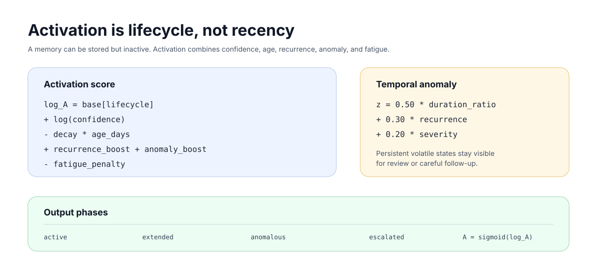

# EvolveMemory runtime reference

[Back to the README](../README.md) · [中文](runtime-reference.zh-CN.md)

These formulas and interfaces describe the deterministic prototype. Module presence does not establish a complete hosted conversation loop or measured real-model improvements.

## Mathematical Runtime

EvolveMemory treats memory behavior as a scored, inspectable decision chain.
Rules are deterministic today, but each important module emits factors,
weights, formulas, rationale, and a version so it can later be calibrated or
learned from feedback.

`ScoreBreakdown` is the common explanation object:

| Field | Example value |
| --- | --- |
| `name` | `retrieval` |
| `score` / `probability` | $0.81$ |
| `factors` | $K=0.50,\ A=0.72,\ G=0.88$ |
| `weights` | $w_K=0.22,\ w_A=0.14,\ w_G=0.06$ |
| `formula` | $S_{\mathrm{ret},v3}$ |
| `rationale` | Career query depends on current work or event state. |
| `version` | `retrieval-v3.0` |

Read the math runtime as one pipeline:

| Stage | Question answered | Output |
| --- | --- | --- |
| Retrieval score | Which candidate memories should be inspected first? | Ranked candidate list. |
| Activation | Is this memory still active at this moment? | Lifecycle-aware factor `A`. |
| Semantic gravity | Should weak-match but high-impact context remain visible? | Impact factor `G`. |
| Causal relevance | Would this memory change the safe or useful answer? | Dependency factor `C`. |
| Use gate | How may ranked memories affect the prompt? | direct, style, follow-up, hidden, summary, suppress. |
| Write governance | Can an LLM proposal become a formal memory? | create, review, merge, supersede, reject. |

### 1. Retrieval Score

Retrieval ranks candidates. It still does not grant permission.

```math
\begin{aligned}
S_{\mathrm{ret},v3}
= \mathrm{clamp}\big(&
0.22K_{\mathrm{keyword}}
+ 0.22E_{\mathrm{embedding}}
+ 0.14F_{\mathrm{freshness}}\\
&+ 0.14L_{\mathrm{layer}}
+ 0.14A_{\mathrm{activation}}
+ 0.08C_{\mathrm{causal}}\\
&+ 0.06G_{\mathrm{gravity}}
\big)
\end{aligned}
```

All factors are normalized to `0..1`, and the weights sum to `1.00`. The
score answers one question only: **which candidates should be inspected
first?** The memory-use gate still decides visibility and allowed use.

| Symbol | Runtime factor | Meaning |
| --- | --- | --- |
| `K` | `keyword` | Lexical overlap with the current query. |
| `E` | `embedding` | Deterministic embedding-like similarity for local tests and demos. |
| `F` | `freshness` | Time freshness of the memory. |
| `L` | `layer_prior` | Whether the query intent wants this memory layer. |
| `A` | `activation` | Lifecycle-aware activation over confidence, age, recurrence, anomaly, fatigue. |
| `C` | `causal_relevance` | Whether the memory changes the safe or useful answer. |
| `G` | `semantic_gravity` | Human-context importance even when wording does not match. |

Retrieval-v3 is intentionally hybrid:

| Layer | Why it exists |
| --- | --- |
| Match | `keyword` and `embedding` keep ordinary relevance strong. |
| Lifecycle | `freshness`, `layer_prior`, and `activation` stop stale or wrong-layer memories from dominating. |
| Impact | `causal_relevance` and `semantic_gravity` recover memories that matter even when wording is weak. |

### 2. Activation And Temporal Anomaly

Some memories can be stored but should not currently affect behavior. Activation
models lifecycle decay, reinforcement, temporal anomaly, and fatigue.

```math
\begin{aligned}
\ell_A
&= b_{\mathrm{lifecycle}}
+ \log(c_{\mathrm{confidence}})
- \lambda_{\mathrm{lifecycle}}a_{\mathrm{days}}\\
&\quad
+ \rho\log(1+r_{\mathrm{count}})
+ \alpha Z_{\mathrm{temporal}}
- \phi f_{\mathrm{fatigue}},\\
A_{\mathrm{activation}}
&= \sigma(\ell_A).
\end{aligned}
```

The anomaly input is derived before activation:

```math
Z_{\mathrm{temporal}}
= 0.50D_{\mathrm{duration}}
+ 0.30R_{\mathrm{recurrence}}
+ 0.20Q_{\mathrm{severity}}.
```

This separates ordinary recency from persistent state risk: a normal preference
can quietly remain long term, while a recurring volatile state can stay visible
for careful follow-up or review.



### 3. Semantic Gravity

Semantic gravity prevents important life or safety context from being lost just
because lexical overlap is weak. Job loss, interviews, exams, health
constraints, relationship transitions, and persistent emotional state can
matter more than a generic preference.

```math
\begin{aligned}
G_{\mathrm{social}}
&= \mathrm{clamp}\!\left(
g_{\mathrm{base}}(k,v)
\cdot w_{\mathrm{culture}}
\cdot m_{\mathrm{life\ stage}}
\right),\\
G_{\mathrm{final}}
&= \mathrm{clamp}\!\left(
\frac{
G_{\mathrm{social}}\left(1+0.35I_{\mathrm{personal}}\right)
}{
1+0.50F_{\mathrm{fatigue}}
}
\right).
\end{aligned}
```

Semantic gravity is not permission either. It only prevents high-impact context
from disappearing before the use gate can decide whether it should be mentioned,
hidden, summarized, or suppressed.


### 4. Causal Relevance

Causal retrieval asks: would this memory change the safe or useful answer?

```math
C(m,q)=R(m,q)
```

The current implementation is not a black-box causal model. It is an auditable
dependency rule set: health or medication constraints score `1.00` for alcohol
queries, career events score about `0.90` for job-search queries, and exam,
relationship, and style queries step down through their own dependency rules.
The goal is to lift answer-changing memories into the candidate set before the
gate decides visibility.

Example: if the user asks whether they can drink at a party, a medication or
allergy memory should surface even when it is not the highest keyword match.
That memory is still only a retrieved candidate; the use gate decides whether
and how it can affect the answer.

## Write Governance And Inference Validation

LLM output is never the writer of record. A model can propose memories, but
validation and deterministic write governance decide whether each candidate is
created, rejected, reviewed, superseded, or merged as evidence.


Write governance uses a weighted score:

```math
\begin{aligned}
S_{\mathrm{write}}
= \mathrm{clamp}\big(&
0.18C_{\mathrm{confidence}}
+ 0.16R_{\mathrm{reuse}}
+ 0.14P_{\mathrm{personalization}}\\
&+ 0.12T_{\mathrm{stability}}
+ 0.10A_{\mathrm{authority}}
+ 0.10E_{\mathrm{evidence}}\\
&+ 0.08N_{\mathrm{novelty}}
+ 0.07U_{\mathrm{actionability}}
+ 0.05V_{\mathrm{privacy}}
\big)
\end{aligned}
```

`S_write` is only the weighted part of the decision. Hard policy checks still
override it: disabled settings reject, explicit do-not-remember rejects,
restricted memories require consent, low-confidence sensitive memories require
review, and contradictions may merge, supersede, or ask the user.

| Symbol | Factor |
| --- | --- |
| `C` | Candidate confidence. |
| `R` | Future reuse value. |
| `P` | Personalization gain. |
| `T` | Temporal stability. |
| `A` | User/source authority. |
| `E` | Evidence quality. |
| `N` | Novelty against existing memory. |
| `U` | Actionability. |
| `V` | Privacy adjustment. |

| Result path | Decision owner |
| --- | --- |
| `create` | Score passes threshold and no review policy blocks it. |
| `review` | Sensitivity, restricted consent, low confidence, or lower authority needs user confirmation. |
| `merge` | Duplicate evidence should attach to an existing record. |
| `supersede` | A higher-or-equal authority candidate replaces an exclusive conflicting value. |
| `reject` | Settings, explicit refusal, hard confidence floor, or low weighted utility blocks the write. |

## Memory-Use Gate And Prompt Safety

The gate turns ranked candidates into allowed actions.

```math
\begin{aligned}
S_{\mathrm{gate}}
= \mathrm{clamp}\big(&
0.22Q_{\mathrm{relevance}}
+ 0.14F_{\mathrm{freshness}}
+ 0.14A_{\mathrm{authority}}\\
&+ 0.16U_{\mathrm{utility}}
+ 0.14P_{\mathrm{privacy}}
+ 0.08M_{\mathrm{preference}}\\
&+ 0.06T_{\mathrm{token}}
+ 0.06D_{\mathrm{contradiction}}
\big)
\end{aligned}
```

The gate is not another retrieval score. It separates usefulness from
visibility: a high-scoring memory may still become `style_only`,
`summarize_only`, or `suppress` because of privacy, allowed-use constraints,
explicit suppression, or sensitive-memory policy.

| Gate action | Prompt channel |
| --- | --- |
| `use_directly` | Direct user facts, only when safe to mention. |
| `style_only` | Style policy without exposing raw private evidence. |
| `follow_up` | At most one short progress cue. |
| `hidden_constraint` | Internal policy constraint, not visible to the user. |
| `clarify` | Ask for current truth before using uncertain memory. |
| `summarize_only` | Aggregate context only, no details. |
| `suppress` | Audit only; not used in the prompt. |

## Developer Surface

```bash
# Run the product replay
python -m memory_system.demo

# Run the original extraction demo
python demo.py

# Start the API
uvicorn app:app --reload

# Use SQLite persistence
AME_STORAGE_BACKEND=sqlite uvicorn app:app --reload
```

Minimal runtime integration:

```python
from datetime import datetime
from zoneinfo import ZoneInfo

from memory_system import SessionMemoryRuntime

runtime = SessionMemoryRuntime(session_id="user-1")
now = datetime(2026, 5, 1, 9, 0, tzinfo=ZoneInfo("Asia/Shanghai"))

runtime.ingest_turn("回答直接一点，先给结论。", "turn_1", now)
context = runtime.prompt_context("帮我 review 这段代码。", now)
print(context["assembled_prompt"])
```

## API Surface

| Endpoint | Purpose |
| --- | --- |
| `POST /v2/users/{user_id}/turns/ingest` | Ingest a user turn or provider-free LLM proposal payload. |
| `POST /v2/users/{user_id}/memory/query` | Retrieve, score, and gate memories for the current query. |
| `POST /v2/users/{user_id}/prompt-context` | Compile model-ready memory context. |
| `GET /v2/users/{user_id}/memory/review-queue` | Inspect memories requiring confirmation. |
| `POST /v2/users/{user_id}/memory/{memory_id}/correct` | Correct and retire conflicting records. |
| `POST /v2/users/{user_id}/memory/forget-all` | Clear memory with audit trail. |
| `GET /v2/users/{user_id}/memory/audit/export` | Export records, settings, events, and audit data. |
