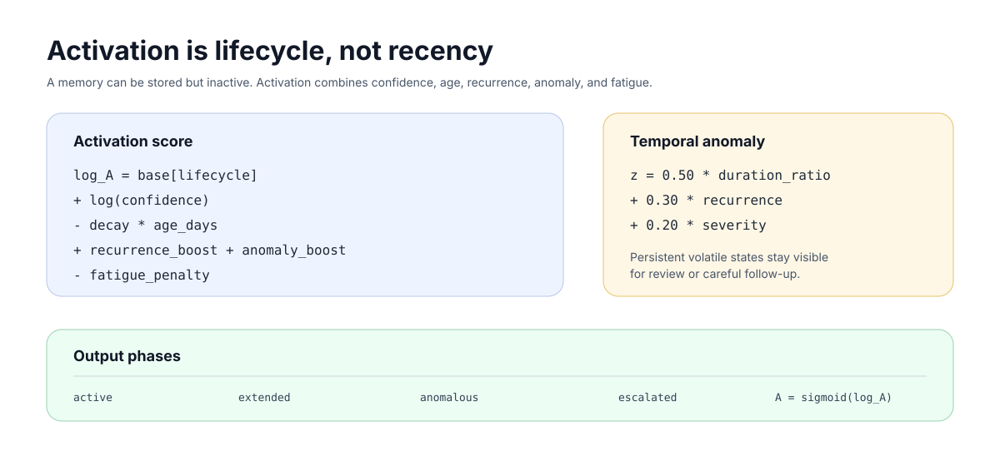
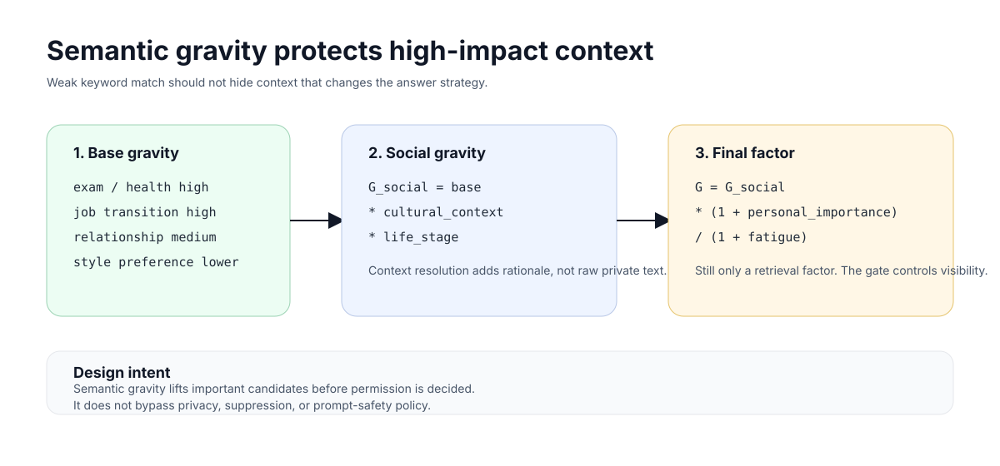
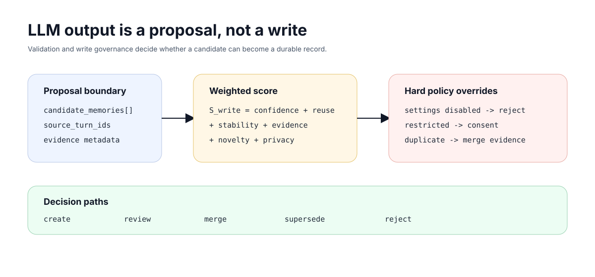

# EvolveMemory 运行时参考

[返回 README](../README.zh-CN.md) · [English](runtime-reference.md)

本文描述确定性记忆治理与可选的真实 DeepSeek 对话宿主。宿主会记录实际模型输入输出；模块存在不代表自然理解已经验收，也不代表跨用户、跨任务的真实模型收益已经测量。

## 2026-11-16 自主理解方向修正

用户在 2026-11-16 后续明确取代了“所有个人画像先确认才适配”的旧选择。当前方向是：AI 从独立证据中自主形成并持续修正对人的理解；普通偏好证据充分时可自动入库，并在相关对话中自然适配，不逐项索取画像确认。弱证据暂存为假设或不使用，不默认转成提问。长期协作与陪伴是愿景，项目任务是首个验证场景。

PR #16 的 U0 基线本地通过：**pytest 157 tests + 101 subtests**、**unittest 157 tests**、**11/11 确定性套件**（`failures=[]`）及 **replay PASS**，使用独立临时数据目录，未调用 provider。见 [PR #16](https://github.com/2sao7sao/EvolveMemory/pull/16)；PR #15 历史证据单独保留。这些历史数量不验证后来新增的真实宿主。当前候选可以来自规则、外部 `llm_payload` 或[真实 DeepSeek 宿主](#live-deepseek-conversation)；宿主将模型输出提交到同一 v2 治理写入入口。自然多轮体验仍在评估。

| 方面 | 修正后的契约 |
| --- | --- |
| 晋升 | 多个独立且可用的来源 turn 可支持自动画像入库与相关的自然风格适配；不普遍要求 `user_review_approved`。模型自评分、同一 turn 的反复提取不足以晋升。 |
| 持续修正 | 明确纠错与反证可降低、替换或退役推断。需区分稳定默认、持续变化与情境例外；广泛覆盖仍是验收目标。 |
| 弱证据 | 保留为暂定假设或抑制，不要求用户逐一核实；仅当前问题存在实质歧义时作必要澄清。 |
| 自然使用 | 相关偏好自然融入回答，不贴画像标签、不反复列来源、不无故提旧事；用户追问原因或变化/冲突需要说明时解释。 |
| 控制边界 | scope、来源有效性、key/layer 禁用、`allow_inferred_profile`、敏感设置和主开关继续约束积累与使用。 |
| Review | 明确配置的 review 及敏感/受限规则继续可用；普通有证据的画像适配默认不等待确认标记。 |

[体验验收 U01–U08](next-development-spec.md#fixed-experience-acceptance)描述待验证行为，不代表真实回答的自然程度已经通过。

### 当前候选实现的具体边界

下列 U0 行为已实现，并由上述历史本地检查覆盖；U01–U08 实际体验尚未验收。当前 S1-a 宿主新增真实模型交付和临时保留期限校验，用于进一步评估：

| 机制 | 当前行为与限制 |
| --- | --- |
| 服务端资格 | 仅服务端根据受控 live evidence pool 授予 `metadata.profile_qualification={"policy_version":"autonomous-v1","method":"scoped_turn_evidence","distinct_turn_count":N}`；外部 `llm_payload` 自报这个标记不授予资格。 |
| 有界证据规则 | 至少 **2 个不同真实来源 turn**、净支持 **≥1.2**，每个 dimension 保留最近 **8 个 turn**，采用 **30 天 half-life** 且无永久权重底线；平局不选。均为工程启发式，不是已经验证的心理或模型质量阈值。 |
| 读取时重算 | query 与 prompt-context 按当前时钟、同 scope 的 live 来源重算资格；没有新 ingest，支持过期/衰减或不可用也可使画像停止参与。这是读取时抑制，不证明完整依赖清理或并发撤销。 |
| Review 默认与迁移 | `review_required_for_layers=[]`。旧设置未标 explicit 且列表恰为 `["inferred_profile"]` 时迁移为自动，旧列表和原因保存在 `legacy_review_required_for_layers`、`review_policy_migration`。旧 schema 无法区分旧默认与用户手动设置的同值列表，因此记录歧义。今后 PUT 设置 review 字段会标 `review_required_for_layers_explicit=true`，明确配置继续保留。 |
| Ingest 重试身份 | 可选 `turn_id` 供宿主在重试时复用同一来源 turn；未提供则每个请求生成新身份。不能宣称默认请求幂等；需要重试去重时由宿主传稳定 ID。 |
| 直接画像纠错 | 显式 `POST /v2/users/{user_id}/memory/{memory_id}/correct` 为纠正值形成新的用户依据。旧推断来源保留在旧版本/审计中，不得继续用旧 evidence pool 筛掉纠正值；编译策略与 prompt 也必须采用纠正值，不能残留旧 high 指令。不伪造 `user_review_approved`，当前设置和 scope 继续生效。 |
| 本轮覆盖 | 两个上下文入口识别有限的当前偏好要求，仅本次抑制冲突旧样式，不写成长期开关或偏好；否定、引文和更广情境理解受规则边界限制。 |
| 自然适配提示 | 提示词要求应用偏好而不复述画像标签、不为展示记忆提旧事；尚无基于回答历史的重复控制器，也未证明真实对话自然度。 |

## PR #15 控制与 scope 基础

以下记录 **PR #15 的控制与 scope 基础**。画像策略由上节修正；其余存储与范围边界继续保留。当前有限窗口宿主已增加真实模型调用和请求记录，但这些记录不是用户收件回执或并发撤销保证；完整 S1 体验尚未验收。这里的范围限制用于本地原型，不等于生产认证或多租户隔离已经验证。

2026-11-16 本地结果：pytest **115 passed、72 subtests passed**；unittest **115 passed**；确定性 eval **11/11**、无失败；adaptive replay **PASS**。独立本地复核未发现本切片范围内的阻断项。这些历史结果属于 [PR #15](https://github.com/2sao7sao/EvolveMemory/pull/15)，已合并至 `8e3ab17` 且[远端 CI 通过](https://github.com/2sao7sao/EvolveMemory/actions/runs/43906016401)。它们不验证本修订的自动理解改动。

### 一条 v2 存储与读取路径

v2 使用 normalized repository 作为唯一读写来源。`turns/ingest` 不再向 legacy session store 双写；`memory/query` 与 `prompt-context` 不隐式回退到 `/sessions` 的旧数据。已有 `/sessions` 数据保留，不删除、不自动搬迁；需要时由应用明确调用现有 `NormalizedSQLiteMemoryRepository.migrate_store(store=..., user_id=..., session_id=..., now=...)` 迁移。旧 session API 和下方独立 Python runtime 示例不具有 v2 用户设置治理，不能混用两者的控制承诺。

两条 v2 读入口共用 `prepare_v2_query`；先选择允许的 scope，再由 `apply_read_controls` 在排序、候选/debug 返回及上下文编译前过滤 key、layer、sensitive 与 profile。被禁记录不会因相关性更高而恢复。写侧也使用当前设置，临时指令、`auto_write=false` 或 master-off 不应派生新的 profile evidence。

### 字段、范围与项目开启

| 入口 / 字段 | 实现语义 |
| --- | --- |
| Ingest `turn_id` | 可选来源身份；宿主重试须复用，省略时每请求生成新值，不是默认幂等。 |
| Ingest `session_id`, `project_id`, `domain` | 由可信宿主提供当前范围；不由 query 自行猜测授权。 |
| Ingest `memory_scope` | 可为 `turn/session/project/domain/global`；未指定时为 `session`。自然语言仅可收窄为临时 turn/session，不能扩大项目或全局分享。 |
| Query / prompt-context `session_id`, `project_id`, `domain` | session 记录按 session 与 project 精确匹配；`None` 表示未绑定值，不表示全用户搜索。 |
| Query / prompt-context `options.candidate_memory_ids` | 可选，最多 50 个 ID；在设置、scope、时间与画像来源复核之后，layer 过滤和评分之前求交集。省略或 `null` 不增加 ID 限制；`[]` 不选择任何存储记忆，本轮偏好仍生效。 |
| Query / prompt-context `options.max_prompt_memories` | 1–50 的整数，限制返回/门控后的记忆数量。真实宿主请求最多 50 条作为模型选择池；最终用最多 10 个选中 ID、上限 12 条重新读取并交付。 |
| Settings `enabled_project_ids` | 默认 `[]`；project scope 读写须先开启相应项目。 |
| Settings `allow_global_memory` | 默认 `false`；global scope 读写须单独开启。 |
| Domain scope | 需显式 domain；携带 project 时，该项目也须已开启。 |

项目开启后，另一个 session 可以读取同项目的 project-scope **记录**；这不等于已经实现跨线程原始会话索引或历史全文检索。不要省略 session/project 来表达“查全部”。

例如，宿主先通过 `PUT /v2/users/{user_id}/memory/settings` 保存：

```json
{"enabled_project_ids": ["project-A"], "allow_global_memory": false}
```

再为 project-A 摄取一条项目记录：

```json
{
  "session_id": "thread-A1",
  "project_id": "project-A",
  "memory_scope": "project",
  "text": "记住，回答直接一点，先给结论。"
}
```

同项目后续 query 可使用 `{"session_id":"thread-A2","project_id":"project-A","query":"在本项目中怎么回答代码 review 问题？"}`。`project-B` 或未绑定 project 不继承 A 的权限；相关度与文字中的“全局”不能打开分享范围。

可信宿主可在 query 或 prompt 请求中使用 `"options":{"candidate_memory_ids":["<受控查询返回的ID>"],"max_prompt_memories":12}` 收窄范围。ID 不能恢复禁用、删除、过期、尚未生效或越界的记录，也不绕过使用门控。显式 `project_id` 会保留项目事实/流程候选，即使风格关键词导致启发式意图误分类；它本身不授予该项目权限。query 与 prompt 各自重新检查当前受控快照，不保证生成期间状态变化的原子性。

### 画像证据、事件追问与复核

- 修正后的默认允许独立证据满足推断规则的画像在当前设置与 scope 内自动适配。PR #15 普遍要求 `metadata.user_review_approved=true` 的旧规则已被取代；明确配置 review 时仍可使用人工批准。被禁用、过期、删除或越界的支持记录不能借画像回填。本地检查覆盖该规则/API 行为，不证明广泛情境理解或真实回答自然度。
- 事件追问默认逐事件关闭。通过 `PUT /v2/users/{user_id}/memory/events/{memory_id}/followup` 与 `{"enabled":true}` 为一个事件开启；`{"enabled":false}` 关闭。它受全局 `allow_event_followup` 和当前记录控制约束；全局开关打开不会批量开启事件。
- Review resolve 在批准时重新读取当前设置。候选排队后若 key/layer/sensitivity/project/global 权限被撤回，返回 **409** 并保持 **pending**，不先标 approved 再失败。
- 纠错只接受 ACTIVE 目标；删除和 forget-all 会撤销相关 pending reviews。审批再次检查 target/source 的状态、scope、设置与时间，不能用排队的旧提案恢复已删除或过期的来源。
- Profile evidence 使用真实 record ID，并与 source_turn_id 共同去重；同一合并 record 的不同源 turn 可以保留，重复源不会被当成新的证据。旧数据库及旧 evidence 唯一约束的无损迁移已有固定测试。
- 事件事实能否作为背景读取与是否允许主动追问分开判断。本轮没有实现“用户已收到追问”的交付回执、并发配额或生成途中的撤销保证。

## Mathematical Runtime

EvolveMemory 把 memory 行为设计成可打分、可解释、可评估的决策链。当前规则是确定性的，
但关键模块都会输出 factors、weights、formula、rationale 和 version，后续可以校准或用反馈数据训练。

`ScoreBreakdown` 是统一解释对象：

| Field | Example value |
| --- | --- |
| `name` | `retrieval` |
| `score` / `probability` | $0.81$ |
| `factors` | $K=0.50,\ A=0.72,\ G=0.88$ |
| `weights` | $w_K=0.22,\ w_A=0.14,\ w_G=0.06$ |
| `formula` | $S_{\mathrm{ret},v3}$ |
| `rationale` | Career query depends on current work or event state. |
| `version` | `retrieval-v3.0` |

这套数学建模按一条流水线阅读：

| 阶段 | 解决的问题 | 产物 |
| --- | --- | --- |
| Retrieval score | 候选记忆先看哪几条。 | 排序后的 candidate list。 |
| Activation | 这条记忆此刻是否仍然活跃。 | lifecycle-aware factor `A`。 |
| Semantic gravity | 词面不强但人类语境重要的记忆是否应被保留。 | impact factor `G`。 |
| Causal relevance | 这条记忆会不会改变安全或有用的回答。 | dependency factor `C`。 |
| Use gate | 排序后的记忆可以如何影响 prompt。 | direct、style、follow-up、hidden、summary、suppress。 |
| Write governance | LLM proposal 能不能成为正式记忆。 | create、review、merge、supersede、reject。 |

### 一、Retrieval Score

Retrieval 只负责候选排序，仍然不等于 permission。v2 的设置和 scope 硬过滤先于以下评分，评分只作用于仍被允许的候选。

```math
\begin{aligned}
S_{\mathrm{ret},v3}
= \mathrm{clamp}\big(&
0.22K_{\mathrm{keyword}}
+ 0.22E_{\mathrm{embedding}}
+ 0.14F_{\mathrm{freshness}}\\
&+ 0.14L_{\mathrm{layer}}
+ 0.14A_{\mathrm{activation}}
+ 0.08C_{\mathrm{causal}}\\
&+ 0.06G_{\mathrm{gravity}}
\big)
\end{aligned}
```

所有因子都归一到 `0..1`，权重和为 `1.00`。这个分数只回答一个问题：
**哪些候选记忆应该优先被检查？** 记忆能否进入回答、以什么方式进入，仍然由 memory-use gate 决定。

| Symbol | Runtime factor | 含义 |
| --- | --- | --- |
| `K` | `keyword` | 与当前 query 的词面重合。 |
| `E` | `embedding` | 用于本地测试和 demo 的确定性 embedding-like similarity。 |
| `F` | `freshness` | 记忆的新鲜度。 |
| `L` | `layer_prior` | 当前 query intent 是否需要这个 memory layer。 |
| `A` | `activation` | 基于 confidence、age、recurrence、anomaly、fatigue 的 lifecycle activation。 |
| `C` | `causal_relevance` | 这条记忆是否会改变安全或有用的回答。 |
| `G` | `semantic_gravity` | 即使词面不重合，也具有人类语境重要性。 |

Retrieval-v3 故意拆成三层：

| Layer | 设计原因 |
| --- | --- |
| Match | `keyword` 和 `embedding` 保证普通相关性仍然有效。 |
| Lifecycle | `freshness`、`layer_prior`、`activation` 防止过期或错层记忆压过当前任务。 |
| Impact | `causal_relevance` 和 `semantic_gravity` 补回词面弱但会改变回答策略的记忆。 |

### 二、Activation And Temporal Anomaly

Memory 可以被存储，但不一定应该在当前时刻影响行为。Activation 控制生命周期衰减、强化、异常放大和疲劳抑制。

```math
\begin{aligned}
\ell_A
&= b_{\mathrm{lifecycle}}
+ \log(c_{\mathrm{confidence}})
- \lambda_{\mathrm{lifecycle}}a_{\mathrm{days}}\\
&\quad
+ \rho\log(1+r_{\mathrm{count}})
+ \alpha Z_{\mathrm{temporal}}
- \phi f_{\mathrm{fatigue}},\\
A_{\mathrm{activation}}
&= \sigma(\ell_A).
\end{aligned}
```

异常分数先单独计算，再进入 activation：

```math
Z_{\mathrm{temporal}}
= 0.50D_{\mathrm{duration}}
+ 0.30R_{\mathrm{recurrence}}
+ 0.20Q_{\mathrm{severity}}.
```

这样 recency 和状态风险不会混在一起：普通偏好可以长期安静存在，反复出现的流动状态会在必要时保持可见，
用于谨慎 follow-up 或 review。



### 三、Semantic Gravity

Semantic gravity 避免重要生活/安全语境因为词面重合弱而丢失。失业、面试、考试、健康约束、
关系变化、持续情绪状态，通常比普通风格偏好更影响回答策略。

```math
\begin{aligned}
G_{\mathrm{social}}
&= \mathrm{clamp}\!\left(
g_{\mathrm{base}}(k,v)
\cdot w_{\mathrm{culture}}
\cdot m_{\mathrm{life\ stage}}
\right),\\
G_{\mathrm{final}}
&= \mathrm{clamp}\!\left(
\frac{
G_{\mathrm{social}}\left(1+0.35I_{\mathrm{personal}}\right)
}{
1+0.50F_{\mathrm{fatigue}}
}
\right).
\end{aligned}
```

Semantic gravity 也不是 permission。它只保证高影响语境不会在进入 gate 之前丢失；最终是 mention、
hidden、summary 还是 suppress，仍然由 use gate 决定。



### 四、Causal Relevance

Causal retrieval 问的是：这条 memory 会不会改变安全或有用的回答？

```math
C(m,q)=R(m,q)
```

当前实现不是黑盒因果模型，而是可审计的规则依赖：健康/药物约束遇到喝酒问题为 `1.00`，
职业事件遇到求职问题约为 `0.90`，考试、关系、风格类 query 会按各自依赖降级。这样做的目标是先把
“会改变回答安全性或实用性”的记忆抬上来，再交给 gate 控制可见性。

例子：用户问今晚聚会能不能喝酒时，药物或过敏相关 memory 应该被召回，即使它不是最高的关键词匹配。
但召回后仍只是 candidate；memory-use gate 决定它能否、以及如何影响回答。

## Write Governance And Inference Validation

LLM output 永远不是 writer of record。模型可以提出 memory proposal，但 validation 和确定性写入治理
决定每个 candidate 是 create、reject、review、supersede，还是只 merge evidence。



写入治理使用加权分数：

```math
\begin{aligned}
S_{\mathrm{write}}
= \mathrm{clamp}\big(&
0.18C_{\mathrm{confidence}}
+ 0.16R_{\mathrm{reuse}}
+ 0.14P_{\mathrm{personalization}}\\
&+ 0.12T_{\mathrm{stability}}
+ 0.10A_{\mathrm{authority}}
+ 0.10E_{\mathrm{evidence}}\\
&+ 0.08N_{\mathrm{novelty}}
+ 0.07U_{\mathrm{actionability}}
+ 0.05V_{\mathrm{privacy}}
\big)
\end{aligned}
```

`S_write` 只是决策里的加权部分。硬策略仍然优先：settings 禁用会 reject，明确 `do_not_remember`
会 reject，restricted memory 需要 consent，低置信 sensitive memory 需要 review，冲突记录会进入
merge、supersede 或 ask-user-confirmation。

| Symbol | Factor |
| --- | --- |
| `C` | Candidate confidence. |
| `R` | Future reuse value. |
| `P` | Personalization gain. |
| `T` | Temporal stability. |
| `A` | User/source authority. |
| `E` | Evidence quality. |
| `N` | Novelty against existing memory. |
| `U` | Actionability. |
| `V` | Privacy adjustment. |

| Result path | 决策来源 |
| --- | --- |
| `create` | 分数过阈值，且没有 review policy 阻挡。 |
| `review` | 明确配置的 review 或敏感/受限规则需要用户输入；普通画像的弱证据保留为暂定或不使用，不默认触发确认。 |
| `merge` | 重复 memory 只追加 evidence，不创建新 record。 |
| `supersede` | 更高或同等 authority 的 candidate 可以替换 exclusive 冲突值。 |
| `reject` | settings、明确拒绝、硬置信度下限或低加权收益阻止写入。 |

## Memory-Use Gate And Prompt Safety

Gate 会把排序后的候选转换为允许的 action。

```math
\begin{aligned}
S_{\mathrm{gate}}
= \mathrm{clamp}\big(&
0.22Q_{\mathrm{relevance}}
+ 0.14F_{\mathrm{freshness}}
+ 0.14A_{\mathrm{authority}}\\
&+ 0.16U_{\mathrm{utility}}
+ 0.14P_{\mathrm{privacy}}
+ 0.08M_{\mathrm{preference}}\\
&+ 0.06T_{\mathrm{token}}
+ 0.06D_{\mathrm{contradiction}}
\big)
\end{aligned}
```

Gate 的核心不是再排序一次，而是把“可用性”和“可见性”分开：高分记忆也可能因为 privacy、allowed_use、
用户显式 suppression 或 sensitive policy 只能进入 `style_only`、`summarize_only`，甚至 `suppress`。

| Gate action | Prompt channel |
| --- | --- |
| `use_directly` | 只有 safe_to_mention 时才进入 direct user facts。 |
| `style_only` | 转成 style policy，不暴露原始私人证据。 |
| `follow_up` | 对已逐个开启且全局允许的事件，最多一个短 progress cue；仍受状态与冷却约束。 |
| `hidden_constraint` | 内部 policy constraint，不对用户可见。 |
| `clarify` | 使用不确定 memory 前先确认当前事实。 |
| `summarize_only` | 只作为聚合上下文，不暴露细节。 |
| `suppress` | 只保留 audit，不进入 prompt。 |

## Developer Surface

```bash
# 运行产品 replay
python -m memory_system.demo

# 运行原始抽取 demo
python demo.py

# 启动 API
uvicorn app:app --reload

# 使用 SQLite 持久化
AME_STORAGE_BACKEND=sqlite uvicorn app:app --reload
```

独立 session runtime 示例（不是 v2 用户设置治理入口，也不会自动应用 v2 项目授权）：

```python
from datetime import datetime
from zoneinfo import ZoneInfo

from memory_system import SessionMemoryRuntime

runtime = SessionMemoryRuntime(session_id="user-1")
now = datetime(2026, 5, 1, 9, 0, tzinfo=ZoneInfo("Asia/Shanghai"))

runtime.ingest_turn("回答直接一点，先给结论。", "turn_1", now)
context = runtime.prompt_context("帮我 review 这段代码。", now)
print(context["assembled_prompt"])
```

## Live DeepSeek conversation

`memory_system/providers.py` 提供纯文本 `ChatClient`；`memory_system/conversation.py` 提供 `ConversationHost` 和 v2 HTTP gateway。`examples/run_live_conversation.py` 将固定的 24 轮[合成场景](../examples/scenarios/project_continuation_zh.json)交给真实 `deepseek-flash`。用户文本是预编脚本，助手回答是未经改写的模型输出。这是可复现的集成实验，不是真实用户研究，也不证明 U01–U08 已验收。[评价标准](live-evaluation-rubric.md)只用于离线评审，不传给模型。

完成 README 的依赖安装后运行：

```bash
python examples/run_live_conversation.py \
  --api-key-file /absolute/private/path/deepseek-key.txt \
  --model deepseek-flash \
  --output data/live-runs/run-01
```

使用仓库外已有私有密钥文件的路径，不把内容复制进源码、对话或命令参数。也支持已有的 `DEEPSEEK_API_KEY` 环境变量；文件有多个密钥时用 `--key-index` 选择。runner 只把凭据交给 provider client，从本地 memory server 的环境中移除 `DEEPSEEK_API_KEY`，不复制密钥文件到运行产物。请求日志不含 Authorization header，但含对话内容，应保持私有。

runner 自行启动仅监听 loopback 的 API，使用新的合成用户并明确开启场景项目，SQLite 保存在运行目录，无需另开 API。`--output` 必须不存在或为空，以保留之前成功和失败的证据。`data/live-runs/` 已被 Git 忽略。可用 `--max-turns 2` 进行短程付费冒烟检查，但部分运行不能证明后期轮次召回。

### 模型与记忆边界

| 阶段 | 契约 |
| --- | --- |
| 近期上下文 | `memory` 和 `recent_only` 两组都最多保留最近两组用户/助手对话，切换 session 时清空。只有记忆组能跨 session 复用已授权的项目记录。 |
| 抽取 | 模型接收当前用户文本、有限近期上下文、允许的记忆摘要、偏好 slots 与输出 schema。evidence 必须是当前用户文本的连续原文；助手背景不等于用户授权。这种子串校验不证明语义蕴含。 |
| 语义复核 | 对同一模型再作一次独立调用，判断支持/反证、当前任务/持久偏好与情境。它仍可能判断错误，不是语义正确性证明。缺失/重复判断不默认支持；只有确实支持且可持久化的提案继续。情境偏好不能伪装为直接事实或无条件枚举。 |
| 旧断言撤回 | 复核器可用当前原文证据和已授权候选ID提出 `memory_retractions`。ingest再次检查用户、精确scope、设置、角色、时间与写入开关；在一个数据库事务内退役旧preference/semantic断言及依赖它的自动画像，保留历史证据和审计，阻止同轮重新加回与重试重复审计。直接撤画像被拒绝，不会顺带删除其所有源。 |
| 保留期限 | 宿主要求输出 `durable`、`state` 或 `turn`，缺失/无效 retention 会被拒绝；`turn` 不进入 ingest，`state` 和 `current_bandwidth` 必须有含时区且晚于当前时间的 `valid_to`。提示词建议短状态通常不超过 48 小时；校验器约束未来到期，不强制 48 小时上限。自然语言临时范围还可进一步收窄持久化。 |
| 偏好校验 | 常规偏好使用 registry key 和枚举值；`current_bandwidth` 仅接受 `busy` 或 `available`。`contextual_` 前缀偏好可保存带情境条件的文字规则。模型直接写画像会被拒绝；非明确自述的 confidence 在进入受控证据积累前最多为 0.75。 |
| 候选池 | ingest 后受控查询返回最多 50 条候选；模型只接收 `model_candidates` 门控安全投影，不把 policy/summary-only 依据恢复为原文。候选已执行设置、scope、时间、画像来源、确定性排序与使用门控。这是有限候选池，不是完整历史或全库语义搜索。 |
| 模型选择 | 模型从池中选最多 10 个不同 ID；未知 ID 被拒绝，格式错误时空选，不回退为使用全部记忆。选择器不接收预期答案或评价标准。 |
| 最终上下文 | 同一 ID 子集再次进入 query 和 prompt-context 的治理检查。回答模型收到编译后的 Prompt、同一次最终 prompt-context 快照内的门控安全 `source_notes`、有限近期上下文及当前问题；不用审计导出或过去原始会话全文回答。 |
| 控制 | 模型选择只能收窄范围，不能开启 project/global 分享、恢复过期或删除记录、绕过当前要求与最终使用门控。请求留痕不证明并发撤销或用户已收到生成答案。 |

抽取和选择都是真实模型调用，仍可能判断错误。枚举校验、证据匹配与确定性治理用于约束决策，不等于广泛情境理解。可见记录超过上限时，初始排序仍可能遗漏相关事实。判断记忆收益前，需检查保存的候选池、选中 ID 与实际回答请求。

### 限额与证据产物

默认 `--max-calls 150`、`--max-cost-usd 2.0`。调用数量统计逻辑 completion，不逐次统计 HTTP 重试；此 runner 的 client 允许每次逻辑调用重试一次。费用保护使用输入/输出用量估算和下一次调用预留估算，不是账号账单硬限制。`estimated_peak_cost_usd` 使用 runner 固定的 `deepseek-flash` 全部输入按缓存未命中计算的费率，**不是账单**；重试或失败请求也可能另行收费。runner 会拒绝其他模型名，其他模型需要另行配置费率假设。

| `--output` 下的产物 | 证据 |
| --- | --- |
| `transcript.html`、`transcript.md` | 两组的用户脚本与原始助手回答，包括未完成运行。 |
| `01-memory.json`、`01-recent_only.json` 等 | 各轮适用的抽取、校验/拒绝、ingest、受控候选池、模型选择、最终 query/prompt、实际回答请求与回复。 |
| `provider_calls.jsonl` | 逻辑调用的实际 request body、回复、用量、模型、延迟和经过处理的失败信息，不含 Authorization header。 |
| `started.json`、`manifest.json` | 源码/场景/评价标准哈希、commit、时间、完成/错误计数、用量与费用估算。 |
| `scenario.json`、`data/memory.sqlite3`、`memory-server.log` | 确切输入脚本与独立的本地运行时状态/日志。 |
| `memory-export.json`、`settings.json` | 成功运行到导出阶段才产生的最终记忆与设置快照，不作为回答输入。 |

应按固定标准评审实际回答；HTTP 成功或召回条数增多不证明有用召回、自然适配或用户认可。保留失败运行，每次重跑使用新目录。

## API Surface

| Endpoint | 作用 |
| --- | --- |
| `POST /v2/users/{user_id}/turns/ingest` | 摄取用户 turn 或校验后的 LLM proposal payload；真实宿主先调用 provider，再提交候选。 |
| `POST /v2/users/{user_id}/memory/query` | 为当前 query 检索、打分并 gate memories；可选候选 ID 仅收窄受控记录。 |
| `POST /v2/users/{user_id}/prompt-context` | 编译 model-ready memory context。 |
| `GET /v2/users/{user_id}/memory/review-queue` | 查看需要确认的 memories。 |
| `POST /v2/users/{user_id}/memory/review-queue/{review_id}/resolve` | 按当前设置批准/拒绝；撤权时返回 409 并保留 pending。 |
| `PUT /v2/users/{user_id}/memory/settings` | 设置主开关、项目/global 开启及 key/layer/feature 控制。 |
| `PUT /v2/users/{user_id}/memory/events/{memory_id}/followup` | 用 `{"enabled": true/false}` 单独开启或关闭事件追问。 |
| `POST /v2/users/{user_id}/memory/{memory_id}/correct` | 纠正并退休冲突 records。 |
| `POST /v2/users/{user_id}/memory/forget-all` | 带 audit trail 清空 memory。 |
| `GET /v2/users/{user_id}/memory/audit/export` | 导出 records、settings、events 和 audit data。 |

[真实评测报告](live-evaluation-results.md)记录了实际抽取和纠错失败；证据是原文子串不代表提案正确理解了原文。

### 修复已有合成试验的记忆

使用 `--resume-run /private/prior-run` 和同项目的合成场景，通过只读 SQLite backup 复制原库；保留设置和用户身份，不恢复近期对话。`initial-memory-export.json`、来源manifest/数据库hash与最终export区分旧错误修复和全新空库。`--rubric /private/frozen-rubric.md`记录另一个场景实际使用的验收文件hash，验收内容不传模型。

同值状态重报会更新有效期。状态、一次任务和情境规则不晋升为稳定画像；简短偏好不再推成认知负荷，忙碌不再推成稳定画像，旧库中这些被移除映射的证据也不能重新授予画像资格。未带新标记的legacy payload维持原兼容契约，并未自动完成语义复核。撤源和自动依赖退役事务原子化，不代表整个ingest或模型生成流程原子化。


### Live host correction semantics (v5)

The host distinguishes the exact allowed assertion from its rendered style policy during semantic review. Before an explicit source retraction it requests a separate contradiction verdict; compatible, missing, duplicate, malformed or uncertain verdicts leave the source active. An invalid extraction cannot initiate a retraction. Valid replacement project facts use normal governed supersession rather than retiring the old fact before validating the replacement.

Project decisions, scope and progress may use `retention=until_changed`: they remain current until superseded, with no guessed deadline. Busy/available remains a typed expiring state, and it does not automatically dictate answer length, order or pace. The independent legacy session profile-inference mappings are outside this host change.

When a fixed preference enum cannot represent a user's explicitly stated positive correction, semantic review may retain an exact current-text rule under a `contextual_` key. It cannot derive the opposite preference from negation alone. These model judgments remain fallible; the unit contracts do not prove semantic correctness.
